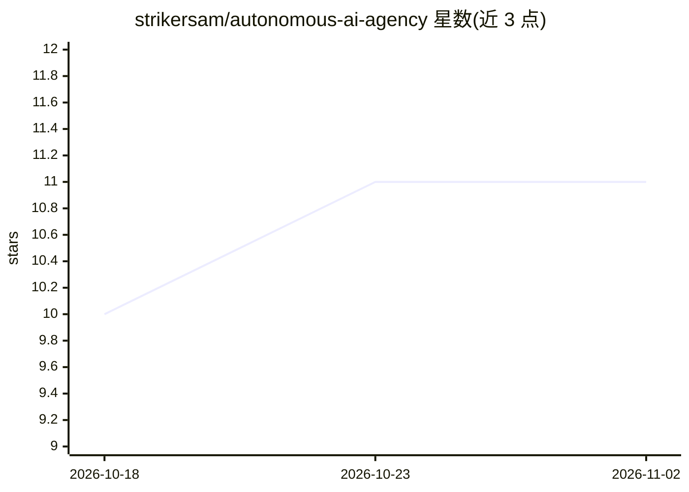

# strikersam/autonomous-ai-agency

⭐ 11 · Python · MIT · 推送 2026-11-01 · [GitHub](https://github.com/strikersam/autonomous-ai-agency) · [官网](https://autonomous-ai-agency.strikersam.workers.dev/home/) · 个人维护

**自托管多 agent 工作平台：CEO agent 调度专家 agent 全天执行任务**

自托管的自主 AI agent 平台：粘贴网站 URL 后进行确定性 SEO/安全审计（0–100 评分），随后由 CEO agent 与 C-suite 顾问团规划任务，分派给运行在十几种 runtime（Hermes、goose、aider、OpenHands 等）上的专家 agent，经 plan→execute→verify 循环写代码、测试并开 PR，合并前需人工审批。内置 AI 网关，暴露 OpenAI/Anthropic/Ollama 兼容接口并做模型路由与提供商故障转移，附预算上限、策略引擎、沙箱等治理机制。面向希望在自己服务器上运行 agent 团队的企业用户，要求 Python 3.11+ 与 Node 20+。

## 筛选速览

| 维度 | 判定 | 备注 |
|---|---|---|
| AI 角色 | `ai-ecosystem` | LLM/agent 周边工具 |
| 许可风险 | `permissive` | MIT |
| 部署形态 | `self-host` | docker 或自建部署 |
| 模型依赖 | local-ok | 支持本地模型 |
| 硬件要求 | — | 无带数字的原话,不猜 |
| 安装摩擦 | `low` | 无编译、无系统依赖或容器化 |
| 成熟度 | — | 结构信号不足 |

## 能力要点

- URL 输入 → 技术栈扫描 → 确定性 SEO/安全审计（0–100 评分、定价发现项）
- CEO agent 协调 C-suite 顾问团与专家 agent，plan→execute→verify 循环交付 PR
- AI 网关：OpenAI/Anthropic/Ollama 兼容接口、任务感知路由与提供商故障转移
- 治理机制：审批门、kill switch、按 agent 的日预算上限、策略引擎与审计日志

## 适用场景

- 在自己服务器上运行 24×7 的 agent 团队完成代码与审计任务
- 为网站快速生成带定价的 SEO/安全审计报告
- 统一接入免费与付费模型并做自动故障转移
- 把 agent 纪律规则与技能包（harness）安装到自己的仓库

## 场景标签

`多智能体` `编码 Agent` `模型网关` · 领域:Agent 开发

## 证据(README 行号)

> L103: |`proxy.py`, `handlers/`, `router/`, `packages/`|The AI gateway: OpenAI / Anthropic / Ollama surfaces, auth, model
> L117: |**AI gateway**|Drop-in OpenAI `/v1/*`, Anthropic `/v1/messages` and Ollama `/api/*`; task-aware routing with fail
> L79: 3. **Specialists execute** through the plan → execute → verify loop, on whichever of a dozen runtimes fits (interna

## 星数曲线

2026-10-18 10 → 2026-11-02 11（+1）

---
*卡片 v1 · prompt 1.4 · 生成 2026-11-01 · 置信度 low · 依据 README sha `f3e9b56c558d` · [字段定义](../../DATASET.md)*
