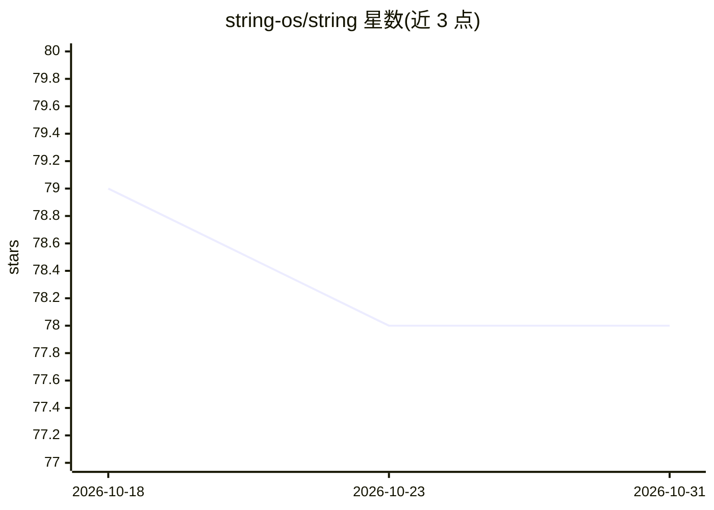

# string-os/string

⭐ 78 · TypeScript · MIT · 推送 2026-10-29 · [GitHub](https://github.com/string-os/string) · [官网](https://string-os.org) · 组织维护

**AI agent 的应用框架与浏览器：统一界面操作文档、应用、网页与 shell**

面向 AI agent 的运行时与界面层：将已安装应用、本地文档、网页、文件、API 与 shell 会话统一为一个 agent 原生表面，agent 通过 /open、/act、/info 三个命令操作任意对象。核心机制是 SFMD（String Flavored Markdown）格式——普通 Markdown 加导航、动作块与响应约定，页面自描述可用操作与参数 schema，无需 SDK。可运行于 CLI、daemon 或单个 MCP 工具；提供 Claude Code 与 Codex 插件安装途径，npm 安装 CLI。限制：本地 shell 命令仅限本地文件或本地安装的应用触发；应用清单维护在独立仓库。

## 筛选速览

| 维度 | 判定 | 备注 |
|---|---|---|
| AI 角色 | `ai-ecosystem` | LLM/agent 周边工具 |
| 许可风险 | `permissive` | MIT |
| 部署形态 | `library` | 以包/库形式分发 |
| 模型依赖 | — | README 未给出锁定关系 |
| 硬件要求 | — | 无带数字的原话,不猜 |
| 安装摩擦 | `low` | 无编译、无系统依赖或容器化 |
| 成熟度 | — | 结构信号不足 |

## 能力要点

- SFMD 格式：Markdown 中嵌入动作块与参数 schema，页面自描述能力
- 同一命令集操作文档/应用/网页/文件/API/shell 会话
- 可作为 CLI、daemon 或单个 MCP 工具运行
- 本地命令边界与按主题作用域的凭据管理

## 适用场景

- 让 agent 用统一命令浏览网页并调用站点暴露的动作
- 把带动作块的 Markdown 文件安装为 agent 可执行应用
- 通过 MCP 在 Claude Code/Codex 等环境中接入 String 运行时
- 构建同时服务人类与 agent 的 HTML+Markdown 双镜像网站

## 场景标签

`Agent 框架` · 领域:Agent 开发

## 证据(README 行号)

> L21: String can run as a CLI, a daemon, or one MCP tool named `string`. The agent
> L172: String serves MCP directly. No separate MCP package is needed.

## 星数曲线

2026-10-18 79 → 2026-10-31 78（-1）

---
*卡片 v1 · prompt 1.4 · 生成 2026-10-24 · 置信度 high · 依据 README sha `cf9839c69453` · [字段定义](../../DATASET.md)*
