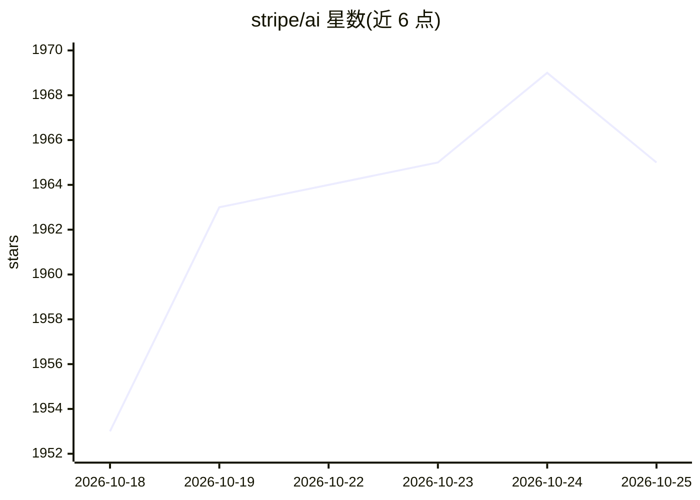

# stripe/ai

⭐ 1,968 · TypeScript · MIT · 推送 2026-10-25 · [GitHub](https://github.com/stripe/ai) · [官网](https://docs.stripe.com/agents) · 组织维护

**Stripe 官方 AI 集成集合：SDK、MCP 服务与 agent 技能**

Stripe 维护的 AI 集成仓库：提供 @stripe/ai-sdk（将 Stripe 计费接入 Vercel 的 ai/@ai-sdk 库）与 @stripe/token-meter（将计费接入 OpenAI、Anthropic、Google Gemini 原生 SDK，无框架依赖）；托管远程 MCP 服务器 mcp.stripe.com，支持 OAuth 安全访问；另提供 agent 技能集合及面向 Claude Code、Codex、Cursor、Grok Build 的官方插件安装命令。面向在 AI 产品中接入 Stripe 计费的开发者，MIT 许可。

## 筛选速览

| 维度 | 判定 | 备注 |
|---|---|---|
| AI 角色 | `ai-ecosystem` | LLM/agent 周边工具 |
| 许可风险 | `permissive` | MIT |
| 部署形态 | `library` | 以包/库形式分发 |
| 模型依赖 | locked-api |  |
| 硬件要求 | — | 无带数字的原话,不猜 |
| 安装摩擦 | `low` | 无编译、无系统依赖或容器化 |
| 成熟度 | — | 结构信号不足 |

## 能力要点

- @stripe/ai-sdk 对接 Vercel ai/@ai-sdk 库
- @stripe/token-meter 对接 OpenAI/Anthropic/Gemini 原生 SDK
- 托管远程 MCP 服务器（OAuth 访问）
- 面向 4 种 agent 客户端的官方插件安装命令

## 适用场景

- 给 LLM 应用按 token 用量做 Stripe 计费
- 通过 MCP 让 agent 安全访问 Stripe 功能
- 为 Claude Code/Cursor 等工具安装 Stripe agent 技能

## 场景标签

 · 领域:支付/LLM 基础设施

## 证据(README 行号)

> L7: It contains a collection of SDKs to help you integrate Stripe with LLMs and agent frameworks, including:
> L9: * `@stripe/ai-sdk` - for integrating Stripe's billing infrastructure with Vercel's `ai` and `@ai-sdk` libraries.
> L10: * `@stripe/token-meter` - for integrating Stripe's billing infrastructure with native SDKs from OpenAI, Anthropic, 

## 星数曲线

2026-10-18 1,953 → 2026-10-25 1,965（+12）

---
*卡片 v1 · prompt 1.4 · 生成 2026-10-21 · 置信度 high · 依据 README sha `c56af36dd7d4` · [字段定义](../../DATASET.md)*
