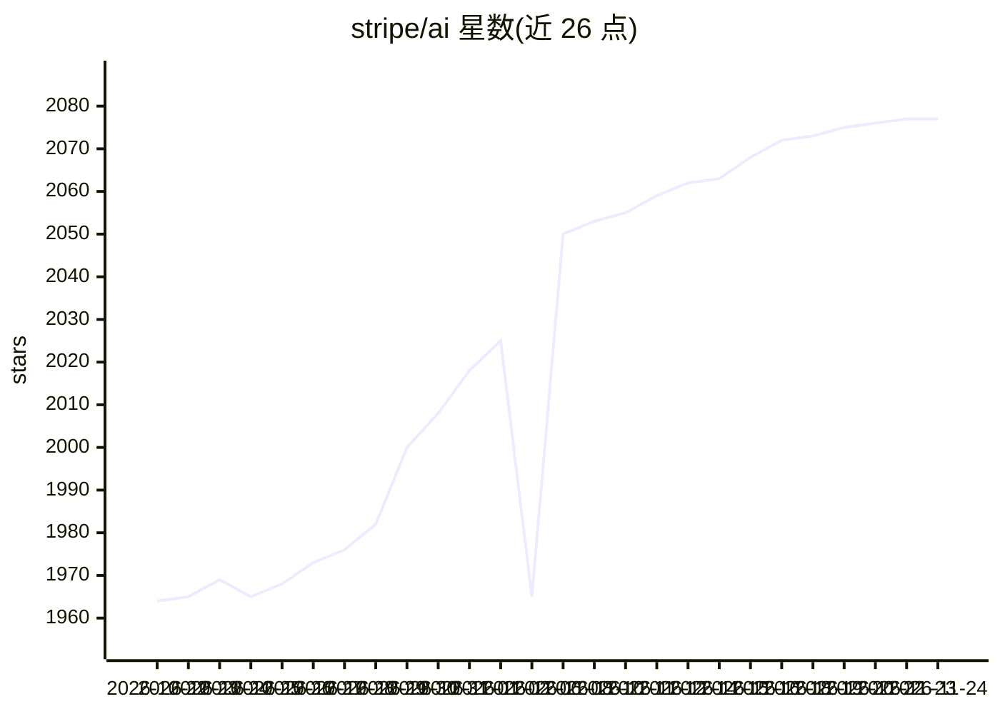

# stripe/ai

⭐ 2,077 · TypeScript · MIT · 推送 2026-11-21 · [GitHub](https://github.com/stripe/ai) · [官网](https://docs.stripe.com/agents) · 组织维护

**为开发者提供在 Stripe 上构建 AI 产品的 agent 插件与技能**

Stripe 官方维护的仓库，包含 agent 插件、agent skills 与基准，用于在 Stripe 之上构建 AI 驱动的产品与业务。Stripe 托管远程 MCP 服务器（mcp.stripe.com），支持 OAuth 的 MCP 客户端访问，并可用于构建自主 agent。提供面向 Claude Code、Codex、Cursor、Grok Build、Gemini 等 agent 宿主的官方插件安装命令，以及通过 npx 的手动技能安装方式。旧版 npm 包（agent-toolkit/mcp/ai-sdk/token-meter）已弃用，仅保留源码供参考。

## 筛选速览

| 维度 | 判定 | 备注 |
|---|---|---|
| AI 角色 | `ai-ecosystem` | LLM/agent 周边工具 |
| 许可风险 | `permissive` | MIT |
| 部署形态 | `library` | 以包/库形式分发 |
| 模型依赖 | locked-api |  |
| 硬件要求 | — | 无带数字的原话,不猜 |
| 安装摩擦 | `low` | 无编译、无系统依赖或容器化 |
| 成熟度 | — | 结构信号不足 |

## 能力要点

- 托管远程 MCP 服务器，OAuth 安全接入
- 面向 Claude Code/Codex/Cursor/Grok Build/Gemini 的官方插件
- 提供 agent skills 集合与手动安装途径
- 旧包已弃用并给出迁移联系方式

## 适用场景

- 让 agent 在开发中按 Stripe 最佳实践集成支付
- 通过 MCP 将 Stripe 接入自主 agent
- 为团队统一安装 Stripe agent 插件

## 场景标签

`编码 Agent` · 领域:编码与开发

## 证据(README 行号)

> L5: This repository contains Stripe agent plugins and skills, and benchmarks for building AI-powered products and busine
> L20: Stripe hosts a remote MCP server at `https://mcp.stripe.com`. This allows secure MCP client access via OAuth. View 
> L26: Agent skills are instructions that agents can use to build faster and more accurately. Stripe offers a collection o

## 星数曲线

2026-10-22 1,964 → 2026-11-24 2,077（+113）

---
*卡片 v1 · prompt 1.4 · 生成 2026-11-23 · 置信度 high · 依据 README sha `8d92ca353ddb` · [字段定义](../../DATASET.md)*
