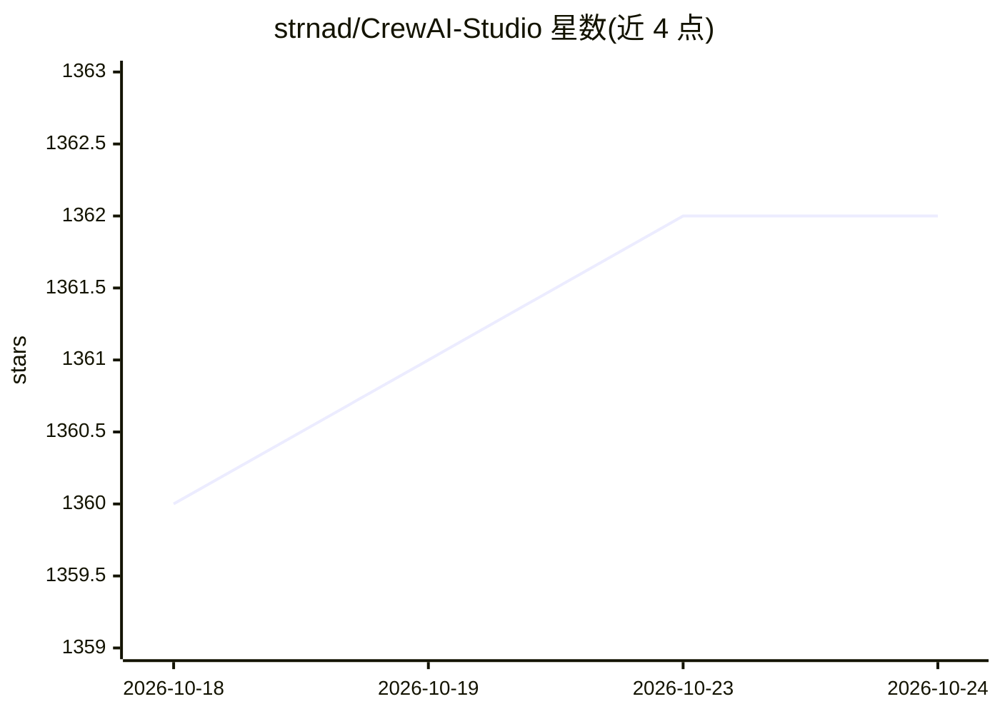

# strnad/CrewAI-Studio

⭐ 1,362 · Python · MIT · 推送 2026-08-03 · [GitHub](https://github.com/strnad/CrewAI-Studio) · 个人维护

**CrewAI 多智能体的图形化管理与运行界面，无需写代码**

基于 Streamlit 的多平台 GUI 应用，用于定义、管理和运行 CrewAI 的 agents、crews 与任务，面向不想写代码的用户。支持 Conda、Python venv 与 Docker Compose 安装，Windows/Linux/macOS 均可运行。功能包括结果历史、知识源、CrewAI 工具与自定义工具（API 调用、代码解释器、网页抓取）、crew 后台线程化运行、导出单页 Streamlit 应用。LLM 后端支持 OpenAI、Groq、Anthropic、ollama、Grok 与 LM Studio；许多工具的 embedding 仍可能需要 OpenAI key。项目处于低维护模式，不开发新功能，但接受 PR 并修复关键问题。

## 筛选速览

| 维度 | 判定 | 备注 |
|---|---|---|
| AI 角色 | `ai-ecosystem` | LLM/agent 周边工具 |
| 许可风险 | `permissive` | MIT |
| 部署形态 | `self-host` | docker 或自建部署 |
| 模型依赖 | local-ok | 支持本地模型 |
| 硬件要求 | — | 无带数字的原话,不猜 |
| 安装摩擦 | `low` | 无编译、无系统依赖或容器化 |
| 成熟度 | — | 结构信号不足 |

## 能力要点

- 图形界面定义与运行 CrewAI crews，无需写代码
- 支持 OpenAI/Groq/Anthropic/ollama/Grok/LM Studio 后端
- 自定义工具：API 调用、文件写入、代码解释器、网页抓取
- crew 可后台线程运行并可停止，支持导出为单页 Streamlit 应用

## 适用场景

- 不写代码就搭建和运行 CrewAI 多智能体任务
- 给团队添加知识源并追踪历史运行结果
- 通过 Docker Compose 自托管使用

## 场景标签

`多智能体` · 领域:Agent 开发

## 证据(README 行号)

> L6: Welcome to CrewAI Studio! This application provides a user-friendly interface written in Streamlit for interacting w
> L11: - **No coding required**: User-friendly interface for interacting with CrewAI.

## 星数曲线

2026-10-18 1,360 → 2026-10-24 1,362（+2）

---
*卡片 v1 · prompt 1.4 · 生成 2026-10-21 · 置信度 high · 依据 README sha `6fdce2543e1e` · [字段定义](../../DATASET.md)*
