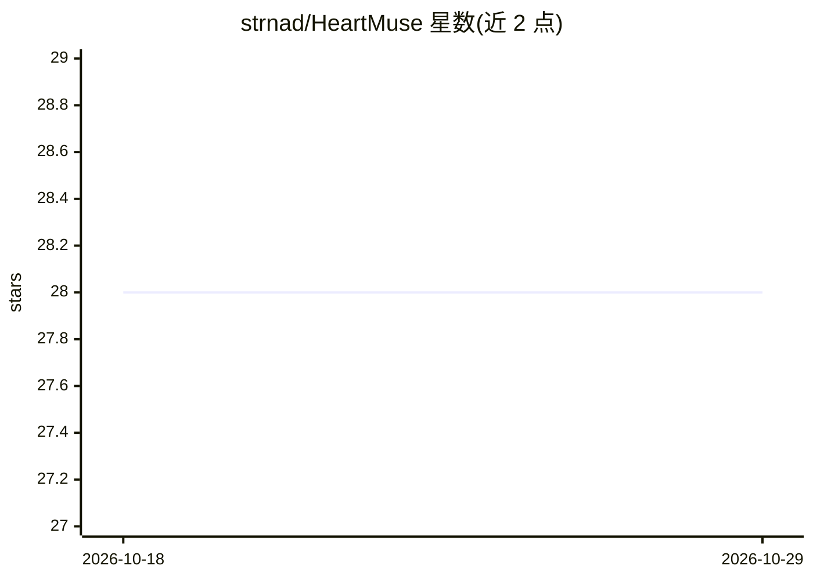

# strnad/HeartMuse

⭐ 28 · Python · MIT · 推送 2026-03-09 · [GitHub](https://github.com/strnad/HeartMuse) · [官网](https://github.com/strnad/HeartMuse) · 个人维护

**本地 AI 音乐生成 Web 界面：LLM 写词 + HeartMuLa 作曲**

基于 Gradio 的本地音乐生成界面：用 Ollama 或 OpenAI LLM 生成/扩写歌词、标题、标签与描述（四个字段可独立控制 AI 参与，引号文本锁定不改），再由 HeartMuLa（3B RL/Base 双变体，最长 240 秒）生成音乐；支持 MuQ-MuLan 风格迁移、Whisper 系 HeartTranscriptor 音频转写、批量 1-10 变体、种子复现、历史播放列表与显存管理。install.sh 一键创建虚拟环境并自动装依赖、克隆 HeartMuLa、首次生成时从 Hugging Face 下载模型。需 NVIDIA GPU 16GB+ 显存，有 CPU 回退（更慢）。面向在本地机器上做音乐创作的用户。

## 筛选速览

| 维度 | 判定 | 备注 |
|---|---|---|
| AI 角色 | `ai-native` | 本体是模型或模型工具 |
| 许可风险 | `permissive` | MIT |
| 部署形态 | `None` |  |
| 模型依赖 | local-ok | 支持本地模型 |
| 硬件要求 | `cpu-ok` | |
| 安装摩擦 | `low` | 无编译、无系统依赖或容器化 |
| 成熟度 | `idea` | |

## 能力要点

- 四字段独立控制的 LLM 文本生成（引号锁定歌词行）
- HeartMuLa 3B 双变体音乐生成，最长 240s，1-10 批量变体与种子复现
- MuQ-MuLan 参考音频风格迁移（CPU 运行）与 Whisper 系音频转写
- Ollama/OpenAI 后端一键切换，100% 本地运行

## 适用场景

- 在本地从创意描述生成完整歌曲（词曲一体）
- 保留自己写的歌词让 AI 补段落、拟标题和风格标签
- 用参考音频影响生成音乐的风格

## 场景标签

 · 领域:AIGC/音乐生成

## 证据(README 行号)

> L3: **HeartMuse** is an intuitive web-based interface for creating high-quality AI-generated music **completely locally*
> L28: - **Smart Text Generation** - AI writes lyrics, titles, tags, and descriptions via Ollama (local) or OpenAI
> L29: - **HeartMuLa Music Generation** - two model variants (RL and Base), up to 240s songs

## 星数曲线

2026-10-18 28 → 2026-10-29 28（+0）

---
*卡片 v1 · prompt 1.4 · 生成 2026-10-26 · 置信度 high · 依据 README sha `03fb34e2aa38` · [字段定义](../../DATASET.md)*
