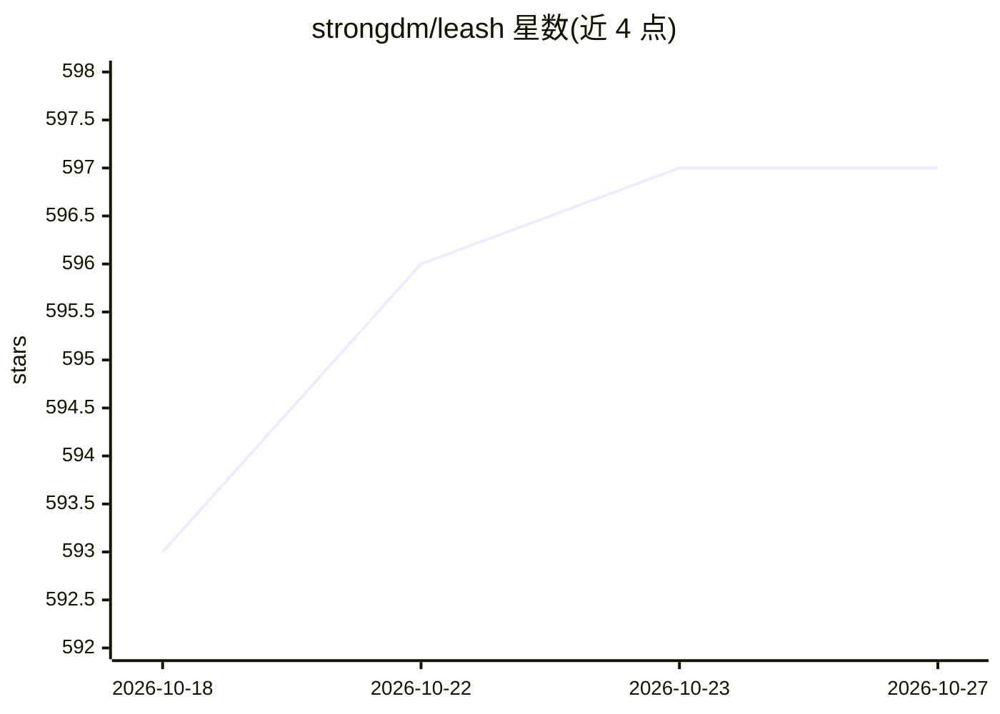

# strongdm/leash

⭐ 597 · Go · Apache-2.0 · 推送 2026-04-06 · [GitHub](https://github.com/strongdm/leash) · [官网](https://leash.strongdm.ai/) · 组织维护

**容器化并监控 AI 编码 agent 的策略执行工具**

由 StrongDM 团队维护：Leash 将 Claude、Codex、Gemini、Qwen、OpenCode 等 AI 编码 agent 包进容器运行，捕获其全部文件系统访问与网络连接，用 Cedar 策略语言即时执行管控并生成审计轨迹；内置 MCP 观察器，检查、记录并约束 agent 的 MCP 工具调用，自动转发常见 API key，Control UI 运行在 localhost:18080。要求 Docker/Podman/OrbStack，支持 macOS 与 Linux（含 WSL），通过 npm、brew 或预编译二进制安装。

## 筛选速览

| 维度 | 判定 | 备注 |
|---|---|---|
| AI 角色 | `ai-ecosystem` | LLM/agent 周边工具 |
| 许可风险 | `permissive` | Apache-2.0 |
| 部署形态 | `desktop` | 安装包/桌面程序 |
| 模型依赖 | — | README 未给出锁定关系 |
| 硬件要求 | — | 无带数字的原话,不猜 |
| 安装摩擦 | `low` | 无编译、无系统依赖或容器化 |
| 成熟度 | `idea` | |

## 能力要点

- 容器化运行 AI 编码 agent 并捕获完整文件系统/网络遥测
- Cedar 策略即时执行与审计轨迹
- MCP 观察器记录并约束 agent 的 MCP 工具调用
- 默认 coder 镜像内置 claude/codex/gemini/qwen/opencode

## 适用场景

- 在沙箱中运行 AI 编码 agent 并限制其文件与网络行为
- 为 agent 的 MCP 工具调用制定策略与留痕审计
- 统一管控团队内多个 AI 编码工具的运行环境

## 场景标签

`网络安全` · 领域:学习与行业

## 证据(README 行号)

> L4: Leash wraps AI coding agents in containers and monitors their activity. You define policies in Cedar; Leash enforces
> L64: Leash includes a Model Context Protocol (MCP) observer that inspects, records, and enforces MCP tool calls made by 

## 星数曲线

2026-10-18 593 → 2026-10-27 597（+4）

---
*卡片 v1 · prompt 1.4 · 生成 2026-10-21 · 置信度 mid · 依据 README sha `b0092d75765d` · [字段定义](../../DATASET.md)*
