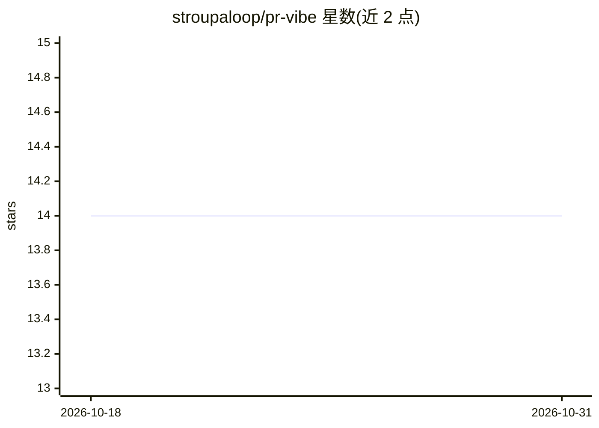

# stroupaloop/pr-vibe

⭐ 14 · JavaScript · MIT · 推送 2025-11-24 · [GitHub](https://github.com/stroupaloop/pr-vibe) · [官网](https://stroupaloop.github.io/pr-vibe/) · 个人维护

**给开发者的 PR 机器人评论自动处理 CLI 工具**

面向使用 PR 审查机器人的开发者的命令行工具：从 GitHub PR 抓取 CodeRabbit、Claude Code、DeepSource 等机器人评论及人类审阅者反馈，按优先级分类（must-fix/suggestion/nitpick），给出修复、解释、推迟或升级的处理建议，并代为回复以完成多轮对话直至解决。通过 .pr-bot/patterns.yml 记忆项目特定模式，支持合并前检查与 GitHub 状态检查。LLM（Claude/GPT-4/Gemini）为可选增强，无 LLM 也可运行。以 npm 包与 npx 方式分发。

## 筛选速览

| 维度 | 判定 | 备注 |
|---|---|---|
| AI 角色 | `ai-ecosystem` | LLM/agent 周边工具 |
| 许可风险 | `permissive` | MIT |
| 部署形态 | `library` | 以包/库形式分发 |
| 模型依赖 | — | README 未给出锁定关系 |
| 硬件要求 | — | 无带数字的原话,不猜 |
| 安装摩擦 | `low` | 无编译、无系统依赖或容器化 |
| 成熟度 | — | 结构信号不足 |

## 能力要点

- 解析多类 PR 审查机器人评论与人类审阅者反馈，按优先级分类
- 处理与机器人的多轮对话，自动检测并等待 rate limit
- 通过 patterns.yml 学习并记忆项目特定模式与有效例外
- 合并前安全检查与 GitHub 状态检查（check/status 命令）

## 适用场景

- 自动回复并解决 PR 审查机器人的重复性评论
- 记住项目惯例，避免反复解释有效例外（如 Lambda 中的 console.log）
- 合并前确认所有机器人评论已解决

## 场景标签

`代码审查` · 领域:编码与开发

## 证据(README 行号)

> L27: PR review bots like CodeRabbit, Claude Code, and DeepSource are great, but they don't understand *your* project. Yo
> L34: - 🤝 **Working WITH bots** - Enhances CodeRabbit, Claude Code, DeepSource, etc. rather than replacing them

## 星数曲线

2026-10-18 14 → 2026-10-31 14（+0）

---
*卡片 v1 · prompt 1.4 · 生成 2026-10-31 · 置信度 high · 依据 README sha `728636ab2282` · [字段定义](../../DATASET.md)*
