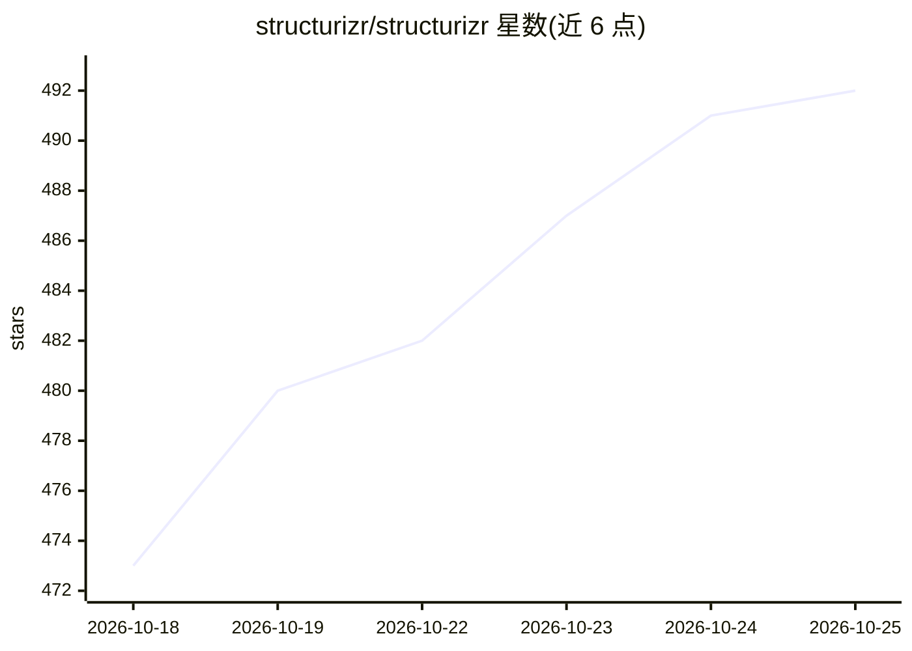

# structurizr/structurizr

⭐ 495 · Java · Apache-2.0 · 推送 2026-10-05 · [GitHub](https://github.com/structurizr/structurizr) · [官网](https://docs.structurizr.com) · 组织维护

**面向 C4 模型的 models-as-code 软件架构图工具**

由 C4 模型作者创建并作为其参考实现的 models-as-code 工具：用户编写 Structurizr DSL 定义单一软件架构模型，再生成多个 C4 视图（如上下文图、容器图、组件图）。面向需要以代码方式维护架构图的软件开发者与架构师。提供在线 playground（playground.structurizr.com）无需安装试用，以及预构建的 Docker 镜像在本地创建图。主题标签含 mcp-server，提示存在面向 AI 客户端的接入能力，但 README 可见文本未描述。

## 筛选速览

| 维度 | 判定 | 备注 |
|---|---|---|
| AI 角色 | `ai-enhanced` | 去掉 AI 部分产品仍成立 |
| 许可风险 | `permissive` | Apache-2.0 |
| 部署形态 | `None` |  |
| 模型依赖 | — | README 未给出锁定关系 |
| 硬件要求 | — | 无带数字的原话,不猜 |
| 安装摩擦 | `low` | 无编译、无系统依赖或容器化 |
| 成熟度 | — | 结构信号不足 |

## 能力要点

- 用 Structurizr DSL 从单一模型生成多个软件架构图
- C4 模型作者的参考实现
- 提供在线 playground 与预构建 Docker 镜像两种快速上手途径
- 主题标签声明提供 MCP server（README 可见文本未展开）

## 适用场景

- 用 DSL 以代码方式维护 C4 软件架构模型与图表
- 在浏览器 playground 中零安装试用 Structurizr
- 在本地通过 Docker 镜像生成架构图

## 场景标签

 · 领域:软件工程/架构建模

## 证据(README 行号)

> L3: Structurizr is a "models as code" tool designed for the C4 model - you write Structurizr DSL to create multiple soft

## 星数曲线

2026-10-18 473 → 2026-10-25 492（+19）

---
*卡片 v1 · prompt 1.4 · 生成 2026-10-21 · 置信度 mid · 依据 README sha `a6f03acf4feb` · [字段定义](../../DATASET.md)*
