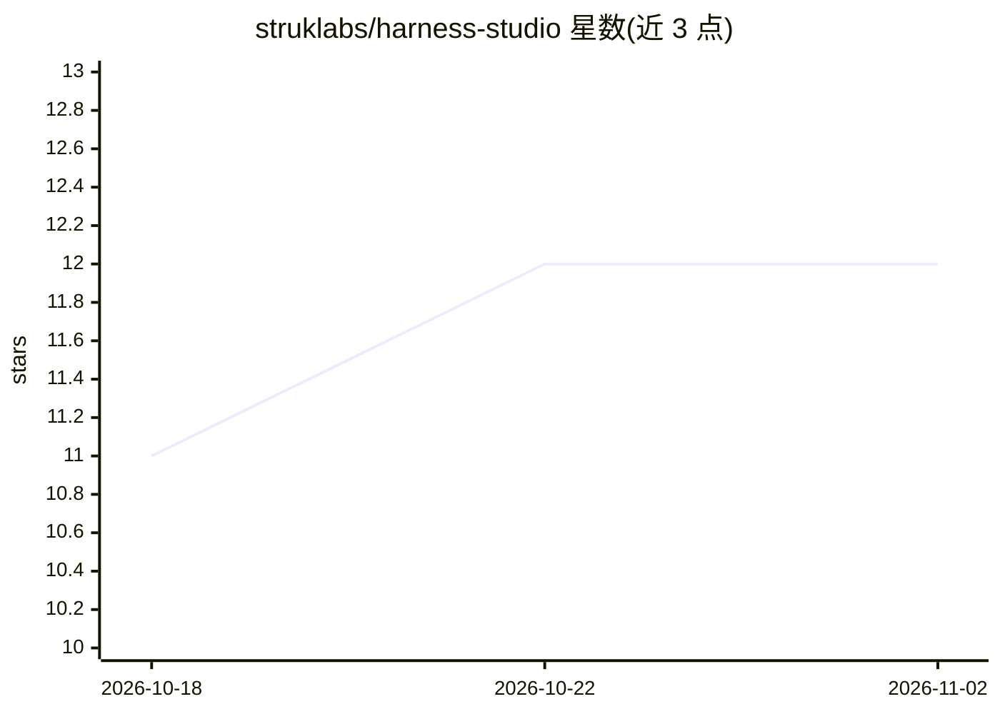

# struklabs/harness-studio

⭐ 12 · Rust · MIT · 推送 2026-10-29 · [GitHub](https://github.com/struklabs/harness-studio) · 组织维护

**本机运行开源 AI 模型的桌面应用与本地网关**

基于 Tauri/Rust/Svelte 5 的桌面应用，管理 llama.cpp 等开源引擎在本机运行模型：为普通用户提供模型搜索、硬件适配检测、下载与聊天界面；为开发者提供兼容 OpenAI/Anthropic/Ollama API 的本地网关、工具调用、MCP 双向支持、CLI 与 Control API，并为 Claude Code、Aider、VS Code 等编码工具提供引导式接入。支持多引擎（whisper.cpp、ONNX Runtime、MLX、stable-diffusion.cpp 等）与多服务器配置、遥测分析。macOS 签名公证，Windows 安装包未签名，Linux 为预览版。

## 筛选速览

| 维度 | 判定 | 备注 |
|---|---|---|
| AI 角色 | `ai-ecosystem` | LLM/agent 周边工具 |
| 许可风险 | `permissive` | MIT |
| 部署形态 | `desktop` | 安装包/桌面程序 |
| 模型依赖 | local-ok | 支持本地模型 |
| 硬件要求 | `cpu-ok` | |
| 安装摩擦 | `medium` | 含编译或系统依赖之一 |
| 成熟度 | `idea` | |

## 能力要点

- 管理 llama.cpp 等多引擎并保留其高级控制项
- 本地网关兼容 OpenAI、Anthropic、Ollama API，模型按需加载卸载
- 为 Claude Code、Aider、VS Code、Zed 等编码工具提供引导式接入与 harness launch
- 按硬件自动选择 CUDA/ROCm/SYCL/Vulkan/Metal/CPU 加速

## 适用场景

- 在本机离线运行开源模型并与模型聊天
- 让本地模型通过 OpenAI 兼容 API 供编辑器和脚本调用
- 对比和观测本地多服务器运行的延迟与性能

## 场景标签

`聊天机器人` `模型网关` `推理引擎` · 领域:Agent 开发

## 证据(README 行号)

> L32: You do not need to be a programmer. The app finds models for you, checks whether they fit your computer, downloads 
> L34: Harness Studio is a desktop app built with Tauri, Rust, and Svelte 5. It manages the open-source engines that actua

## 星数曲线

2026-10-18 11 → 2026-11-02 12（+1）

---
*卡片 v1 · prompt 1.4 · 生成 2026-10-31 · 置信度 high · 依据 README sha `7652e7fdec62` · [字段定义](../../DATASET.md)*
