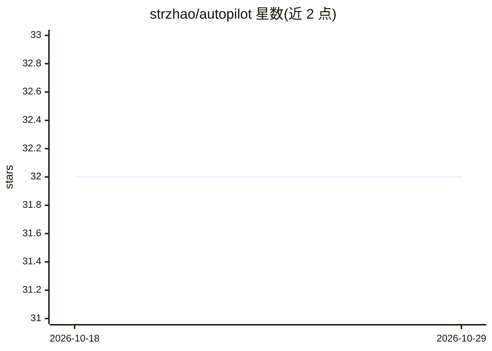

# strzhao/autopilot

⭐ 32 · Shell · MIT · 推送 2026-10-28 · [GitHub](https://github.com/strzhao/autopilot) · 个人维护 · 中文 README

**Claude Code/Codex 的状态机循环引擎插件：目标进、合并 PR 出**

面向 AI 编程 agent 的插件，以 6 阶段状态机循环（设计→实现→QA→自动修复→合并）驱动任务从目标到合并提交。关键机制：红/蓝对抗式实现（红队只依据设计文档写验收测试、蓝队只依据计划实现，隔离由白名单与 sha256 锁强制）、证据门控验收（谓词全 PASS 且 0 critical 才可合并）、知识工程（每次合并抽取决策与经验供后续任务消费）。默认两次人工干预（设计评审、最终验收），支持 auto-approve 与 headless 模式。经 Claude Code 插件市场或 git clone 安装，MIT 许可。

## 筛选速览

| 维度 | 判定 | 备注 |
|---|---|---|
| AI 角色 | `ai-ecosystem` | LLM/agent 周边工具 |
| 许可风险 | `permissive` | MIT |
| 部署形态 | `None` |  |
| 模型依赖 | — | README 未给出锁定关系 |
| 硬件要求 | — | 无带数字的原话,不猜 |
| 安装摩擦 | `low` | 无编译、无系统依赖或容器化 |
| 成熟度 | — | 结构信号不足 |

## 能力要点

- 6 阶段状态机循环，读取持久化状态文件注入指令
- 红/蓝对抗实现：白名单、路径交接、sha256 防篡改强制隔离
- 证据门控合并：并行命令+真实场景冒烟+独立 AI 审查五层防御
- doctor 14 维适航扫描与功能×维度兼容性矩阵

## 适用场景

- 让编码 agent 无人值守地从目标跑到合并提交
- 用证据门控阻止 agent 在测试未过时宣称完成
- 在 CI 中以 headless 模式运行可审计的自动循环
- 通过红蓝对抗生成独立验收测试

## 场景标签

`编码 Agent` · 领域:编码与开发

## 证据(README 行号)

> L3:  A state-machine loop engine that takes a coding agent from goal to merged PR.
> L9:  Claude Code plugin
> L90: git clone https://github.com/strzhao/autopilot.git && cd autopilot && codex

## 星数曲线

2026-10-18 32 → 2026-10-29 32（+0）

---
*卡片 v1 · prompt 1.4 · 生成 2026-10-25 · 置信度 high · 依据 README sha `02f37b1ccd01` · [字段定义](../../DATASET.md)*
