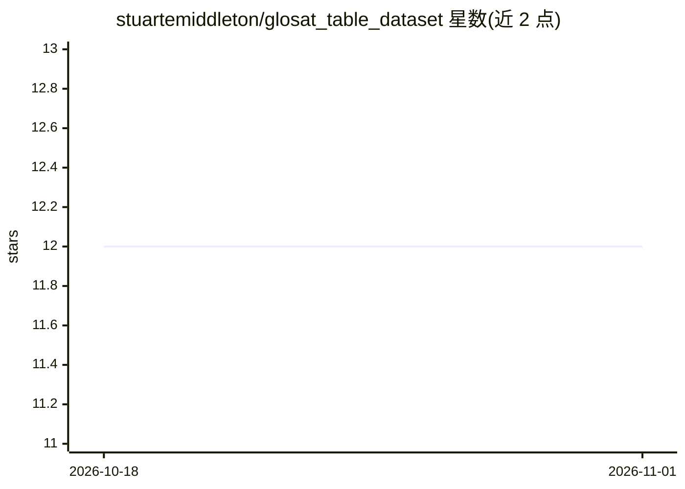

# stuartemiddleton/glosat_table_dataset

⭐ 12 · Python · NOASSERTION · 推送 2025-12-03 · [GitHub](https://github.com/stuartemiddleton/glosat_table_dataset) · 组织维护

**历史测量表格数据集：供表格检测与结构识别模型训练评测**

GloSAT 项目发布的数据集，含 500 张来自船舶日志与陆地测量站的扫描历史表格图像（710 个表格、573 个表头），标注覆盖表格、单元格、标题、表头与题注的边界。随数据附带基于 mmdetection 的 CascadeTabNet 训练、推理与评测代码，并提供 HIP-2021 论文所用预训练模型以便复现。另含启发式表格单元生成与半监督微调流程。数据与模型检查点从 Zenodo 下载，安装基于 Ubuntu 20.04 + conda。

## 筛选速览

| 维度 | 判定 | 备注 |
|---|---|---|
| AI 角色 | `ai-knowledge` | 知识聚合/清单类 |
| 许可风险 | `none` | NOASSERTION |
| 部署形态 | `None` |  |
| 模型依赖 | — | README 未给出锁定关系 |
| 硬件要求 | — | 无带数字的原话,不猜 |
| 安装摩擦 | `low` | 无编译、无系统依赖或容器化 |
| 成熟度 | — | 结构信号不足 |

## 能力要点

- 500 张标注图像，标注覆盖表格/单元格/标题/表头/题注边界
- 附训练、推理与评测代码，含 HIP-2021 预训练模型可直接复现
- 启发式表格单元生成（质心分析、网格对齐、噪声过滤）
- 半监督微调流程：用弱标注数据迭代提升模型表现

## 适用场景

- 训练和评测历史文档表格检测/结构识别模型
- 复现 HIP-2021 论文实验结果
- 对新的历史表格图像做结构识别推理

## 场景标签

`模型评测` `微调` · 领域:评测与运维

## 证据(README 行号)

> L4: Dataset containing scanned historical measurement table documents from ship logs and land measurement stations. Anno
> L6: This dataset release includes code to train models on a training split, to use trained model checkpoints for inferen

## 星数曲线

2026-10-18 12 → 2026-11-01 12（+0）

---
*卡片 v1 · prompt 1.4 · 生成 2026-10-31 · 置信度 high · 依据 README sha `9487782bc16f` · [字段定义](../../DATASET.md)*
