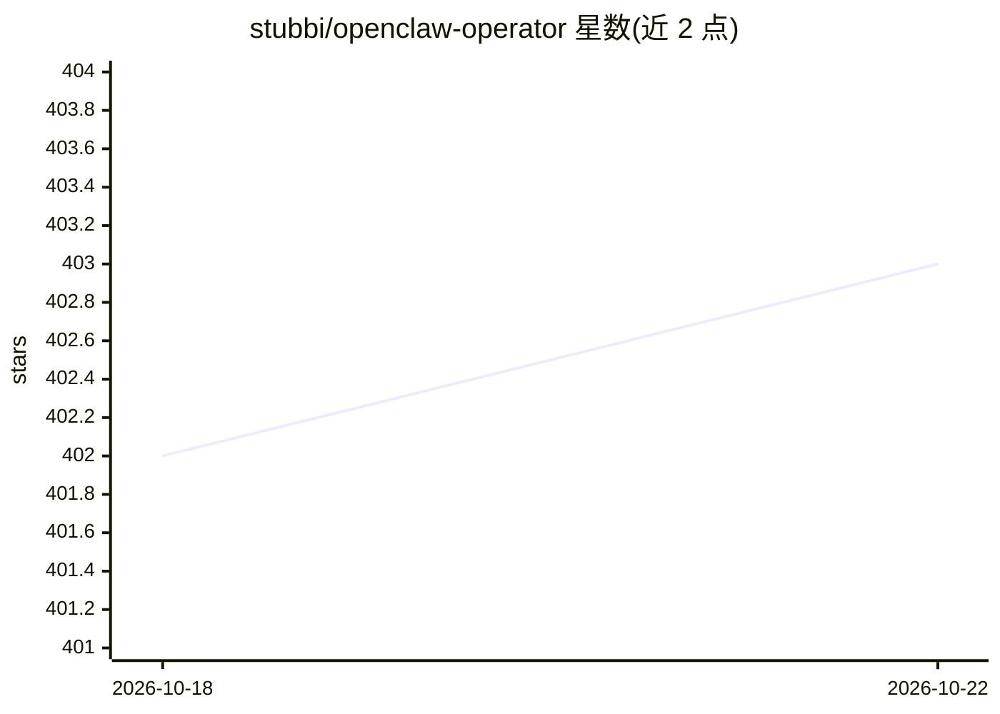

# stubbi/openclaw-operator

⭐ 403 · Go · Apache-2.0 · 推送 2026-10-11 · [GitHub](https://github.com/stubbi/openclaw-operator) · [官网](https://paperclip.inc/openclaw) · 组织维护 · 中文 README

**在 Kubernetes 上自托管 OpenClaw AI agent 的运维 operator**

以 Go 编写的 Kubernetes Operator，通过单一 OpenClawInstance 自定义资源将 OpenClaw AI agent 实例部署为包含 StatefulSet、RBAC、NetworkPolicy、PVC、Ingress 等的完整托管栈，供希望在自有基础设施运行 OpenClaw 而非使用 Paperclip Inc 托管服务的团队使用。机制涵盖默认加固安全配置（非 root、只读根文件系统、默认拒绝网络策略）、agent 经 K8s API 自配置并按白名单校验、S3 备份恢复、OCI 版本自动更新与回滚、Prometheus 指标。限制：需 Kubernetes 1.28+ 与 Helm 3，部分能力（磁盘感知就绪探针、自配置）为可选开启。

## 筛选速览

| 维度 | 判定 | 备注 |
|---|---|---|
| AI 角色 | `ai-ecosystem` | LLM/agent 周边工具 |
| 许可风险 | `permissive` | Apache-2.0 |
| 部署形态 | `library` | 以包/库形式分发 |
| 模型依赖 | local-ok | 支持本地模型 |
| 硬件要求 | — | 无带数字的原话,不猜 |
| 安装摩擦 | `medium` | 含编译或系统依赖之一 |
| 成熟度 | — | 结构信号不足 |

## 能力要点

- 单一 OpenClawInstance CR 声明式生成 9+ Kubernetes 资源栈
- agent 可经 K8s API 自装技能/改配置，逐请求按白名单校验
- 默认安全加固：非 root UID 1000、只读根文件系统、seccomp、默认拒绝 NetworkPolicy
- S3 快照备份恢复与 OCI registry 轮询的自动更新/回滚

## 适用场景

- 在自有 Kubernetes 集群上以生产配置运行 OpenClaw agent
- 多团队按命名空间划分托管多个 agent 实例
- 对 agent 实例做自动备份、版本追踪与自愈运维

## 场景标签

 · 领域:云原生/AI agent 基础设施

## 证据(README 行号)

> L11: **Self-host OpenClaw AI agents on Kubernetes with production-grade security, observability, and lifecycle managemen
> L26: The operator reconciles this into a fully managed stack of 9+ Kubernetes resources: secured, monitored, and self-he
> L59: |**Flexible**|Provider-agnostic config|Use any AI provider (Anthropic, OpenAI, or others) via environment variables

## 星数曲线

2026-10-18 402 → 2026-10-22 403（+1）

---
*卡片 v1 · prompt 1.4 · 生成 2026-10-21 · 置信度 mid · 依据 README sha `57e9096e4496` · [字段定义](../../DATASET.md)*
