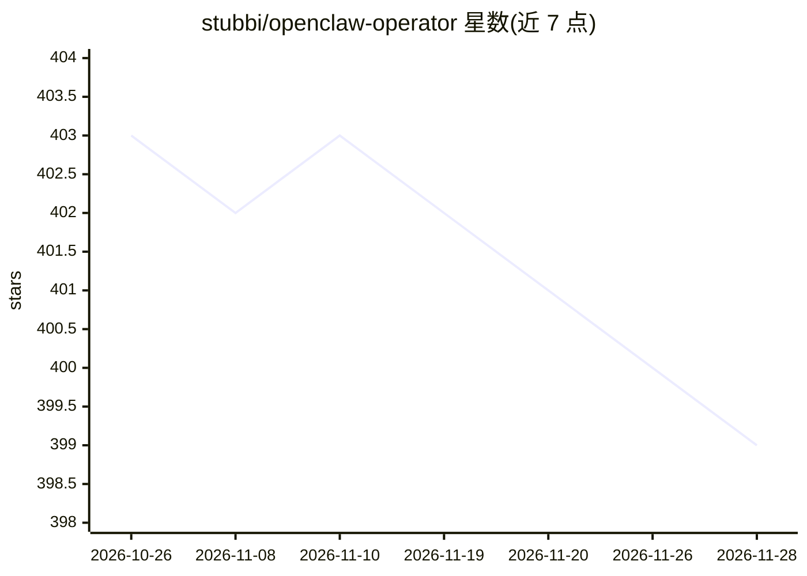

# stubbi/openclaw-operator

⭐ 399 · Go · Apache-2.0 · 推送 2026-11-19 · [GitHub](https://github.com/stubbi/openclaw-operator) · [官网](https://paperclip.inc/openclaw) · 组织维护

**在 Kubernetes 上部署与管理 OpenClaw AI agent 实例的 operator**

用 Go 编写的 Kubernetes operator，通过单个 OpenClawInstance CRD 声明式创建 OpenClaw agent 实例，调和为 StatefulSet、Service、RBAC、NetworkPolicy、PVC、PDB、Ingress 等 9+ 个资源。提供 non-root 与只读文件系统等默认加固、Prometheus 指标、agent 通过 K8s API 自装技能/改配置的 allowlist 校验机制、S3 备份、HPA 自动伸缩与 OCI registry 自动更新回滚。面向在自有基础设施上自托管 OpenClaw 的团队，前置要求 Kubernetes 1.28+ 与 Helm 3。

## 筛选速览

| 维度 | 判定 | 备注 |
|---|---|---|
| AI 角色 | `ai-ecosystem` | LLM/agent 周边工具 |
| 许可风险 | `permissive` | Apache-2.0 |
| 部署形态 | `library` | 以包/库形式分发 |
| 模型依赖 | local-ok | 支持本地模型 |
| 硬件要求 | — | 无带数字的原话,不猜 |
| 安装摩擦 | `medium` | 含编译或系统依赖之一 |
| 成熟度 | — | 结构信号不足 |

## 能力要点

- 单个 CRD 声明整套 K8s 资源栈（StatefulSet/RBAC/NetworkPolicy 等 9+）
- agent 通过 OpenClawSelfConfig CR 自装技能与改配置，operator 按 allowlist 策略校验
- S3 备份/恢复、HPA 自动伸缩、OCI registry 轮询更新与失败自动回滚
- 可选 sidecar：Chromium 浏览器自动化、Ollama 本地 LLM、Tailscale

## 适用场景

- 在自己的 Kubernetes 集群中自托管 OpenClaw agent 实例
- 给多团队提供命名空间隔离的 agent 部署（watchNamespaces 限定 RBAC）
- 需要对 agent 工作区做定时 S3 备份与磁盘水位就绪检查的运维场景

## 场景标签

 · 领域:云原生/AI agent 运维基础设施

## 证据(README 行号)

> L11: **Self-host OpenClaw AI agents on Kubernetes with production-grade security, observability, and lifecycle managemen
> L17: Deploying AI agents to Kubernetes involves more than a Deployment and a Service. You need network isolation, secret
> L26: The operator reconciles this into a fully managed stack of 9+ Kubernetes resources: secured, monitored, and self-he

## 星数曲线

2026-10-26 403 → 2026-11-28 399（-4）

---
*卡片 v1 · prompt 1.4 · 生成 2026-11-25 · 置信度 mid · 依据 README sha `ed2c19152226` · [字段定义](../../DATASET.md)*
