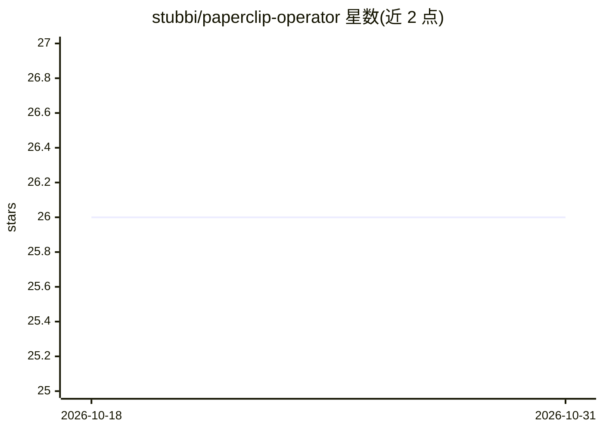

# stubbi/paperclip-operator

⭐ 26 · Go · Apache-2.0 · 推送 2026-10-25 · [GitHub](https://github.com/stubbi/paperclip-operator) · [官网](https://paperclip.inc) · 组织维护

**在 Kubernetes 上部署管理 Paperclip AI agent 平台的 Operator**

Go 编写的 Kubernetes Operator，通过单个 Instance 自定义资源（CRD）声明式部署和管理 Paperclip（开源 AI agent 编排平台）实例：自动调和生成 StatefulSet、Service、PVC、NetworkPolicy、HPA、PDB 等资源栈。支持托管 PostgreSQL 17（或外部库/嵌入式 PGlite）、Better Auth 认证生命周期（OAuth、邮件验证、管理员引导）、S3/MinIO/R2 对象存储、S3 定时备份、内置加密 secrets、隔离的 Cloud Sandbox agent 运行时 pod、LLM API key 注入与插件声明式安装。前提需 Kubernetes 1.28+ 与 Helm 3（或 kubectl/Kustomize）。

## 筛选速览

| 维度 | 判定 | 备注 |
|---|---|---|
| AI 角色 | `ai-ecosystem` | LLM/agent 周边工具 |
| 许可风险 | `permissive` | Apache-2.0 |
| 部署形态 | `library` | 以包/库形式分发 |
| 模型依赖 | — | README 未给出锁定关系 |
| 硬件要求 | — | 无带数字的原话,不猜 |
| 安装摩擦 | `medium` | 含编译或系统依赖之一 |
| 成熟度 | — | 结构信号不足 |

## 能力要点

- 单个 Instance CRD 生成完整 Kubernetes 资源栈（StatefulSet/HPA/PDB/NetworkPolicy 等）
- 三种数据库模式：托管 PostgreSQL 17、外部库、嵌入式 PGlite
- Cloud Sandbox：隔离 pod 中运行 agent、持久工作区、推理计量代理
- S3 定时备份、加密 secrets、声明式插件安装

## 适用场景

- 运维人员用一条 CRD 在集群内拉起生产级 Paperclip 实例
- 为 agent 平台配置隔离沙箱、S3 存储与定时备份
- 通过 HPA 与 PDB 管理 Paperclip 实例的扩缩与可用性

## 场景标签

`Agent 框架` · 领域:Agent 开发

## 证据(README 行号)

> L9: **Deploy and manage Paperclip AI agent orchestration instances on Kubernetes with production-grade security, observa
> L11: Paperclip is an open-source AI agent orchestration platform. While you can deploy it manually, production Kubernete

## 星数曲线

2026-10-18 26 → 2026-10-31 26（+0）

---
*卡片 v1 · prompt 1.4 · 生成 2026-10-26 · 置信度 high · 依据 README sha `3566197ed40a` · [字段定义](../../DATASET.md)*
