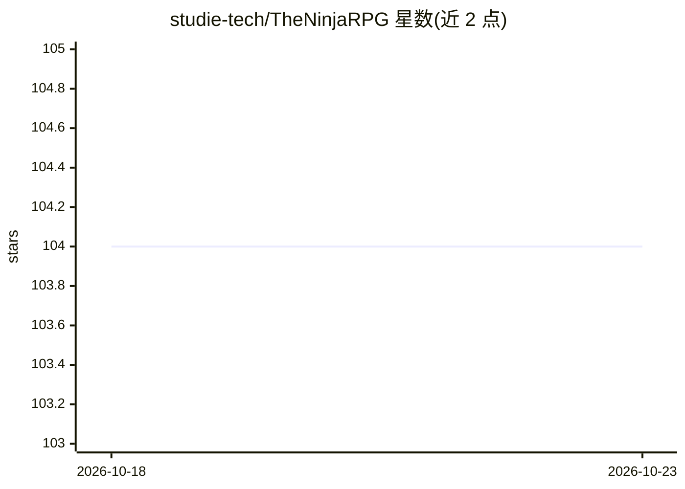

# studie-tech/TheNinjaRPG

⭐ 104 · TypeScript · 推送 2026-10-22 · [GitHub](https://github.com/studie-tech/TheNinjaRPG) · [官网](https://www.theninja-rpg.com) · 组织维护

**火影忍者题材网页 RPG（TheNinja-RPG）官方源码，T3 技术栈**

基于 Next.js/Clerk/tRPC/PlanetScale/Drizzle/Tailwind（T3 栈）的网页文字 RPG 官方源码。本地运行需注册 Clerk（认证，必需）、UploadThing（文件上传，可选）、Replicate（AI 推理，可选）等外部服务账号，通过 Make 命令（setup/install/dbpush/seed/start）完成环境搭建；支持 Git worktree 并行开发、五种游戏界面布局、Chrome DevTools MCP 隔离测试。源码未附加许可证，作者保留全部版权。

## 筛选速览

| 维度 | 判定 | 备注 |
|---|---|---|
| AI 角色 | `ai-enhanced` | 去掉 AI 部分产品仍成立 |
| 许可风险 | `none` | — |
| 部署形态 | `None` |  |
| 模型依赖 | — | README 未给出锁定关系 |
| 硬件要求 | — | 无带数字的原话,不猜 |
| 安装摩擦 | `medium` | 含编译或系统依赖之一 |
| 成熟度 | — | 结构信号不足 |

## 能力要点

- Make 命令驱动的本地开发流程（bun 安装、建表、种子数据、启动）
- 依赖 Clerk 认证（必需）与可选的 UploadThing 文件上传、Replicate AI 推理
- 五种游戏/欢迎页布局切换（Classic/Pixel/Eclipse 等）
- Git worktree 并行开发与共享 Docker 服务复用

## 适用场景

- 本地搭建并开发 TheNinja-RPG 游戏功能
- 了解 T3 栈网页游戏的完整工程结构
- 参与游戏社区的源码贡献开发

## 场景标签

 · 领域:游戏/全栈 Web 应用

## 证据(README 行号)

> L3: This is the official source code for the game www.TheNinja-RPG.com.
> L10: - https://uploadthing.com/ - for file uploads (optional)
> L11: - https://replicate.com/ - for AI inference (optional)

## 星数曲线

2026-10-18 104 → 2026-10-23 104（+0）

---
*卡片 v1 · prompt 1.4 · 生成 2026-10-23 · 置信度 high · 依据 README sha `bd8531fdb61d` · [字段定义](../../DATASET.md)*
