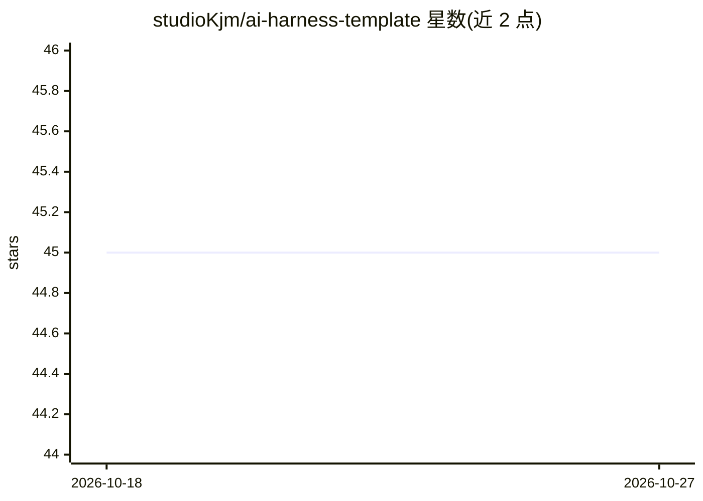

# studioKjm/ai-harness-template

⭐ 45 · Python · MIT · 推送 2026-10-15 · [GitHub](https://github.com/studioKjm/ai-harness-template) · 个人维护 · 中文 README

**给 AI 编码代理配结构化护栏与工作流的 Claude Code 模板**

面向使用 Claude Code 等 AI 编码代理的开发者的工程模板：以命令行脚本或 /install 向导安装到目标项目，提供 12 个命令（/interview→/seed→/trd→/decompose→/run→/evaluate 等规格驱动开发循环）、12 个检查门（层级分离、密钥、安全、依赖审计等，违规时通过 pre-commit 阻断提交）、权限预设与 subagent 分工。方法论以插件形式提供 16 种（ouroboros、bdd、tdd-strict 等），核心门始终强制。Pro 跟踪依赖 Python，另有 MCP server 与 GitHub Actions 集成。

## 筛选速览

| 维度 | 判定 | 备注 |
|---|---|---|
| AI 角色 | `ai-ecosystem` | LLM/agent 周边工具 |
| 许可风险 | `permissive` | MIT |
| 部署形态 | `library` | 以包/库形式分发 |
| 模型依赖 | — | README 未给出锁定关系 |
| 硬件要求 | — | 无带数字的原话,不猜 |
| 安装摩擦 | `low` | 无编译、无系统依赖或容器化 |
| 成熟度 | — | 结构信号不足 |

## 能力要点

- 12 个命令组成规格驱动开发循环（interview→seed→…→evolve）
- 12 个检查门：层级分离/密钥/SAST/依赖审计等，pre-commit 自动阻断
- 16 种方法论插件可组合，核心 7 门始终强制
- 三档权限预设（strict/standard/permissive）与 MCP server
- git clone + init.sh 一行安装，声明零依赖

## 适用场景

- 在 Claude Code 中以规格优先流程开发新项目
- 通过 pre-commit 门禁阻止 AI 生成违规代码合入
- 按团队规模选择方法论组合（如 ouroboros+bmad-lite）

## 场景标签

`编码 Agent` · 领域:编码与开发

## 证据(README 行号)

> L5: AI 에이전트가 자율적으로 일하되, 안전하게 통제할 수 있는 환경을 만드는 템플릿.
> L214: |1|**규칙 전달** (CLAUDE.md)|AI가 읽는 컨텍스트 파일|`CLAUDE.md.hbs`, `ARCHITECTURE_INVARIANTS.md.hbs`, `code-convention.yaml`|

## 星数曲线

2026-10-18 45 → 2026-10-27 45（+0）

---
*卡片 v1 · prompt 1.4 · 生成 2026-10-25 · 置信度 mid · 依据 README sha `6bf6127c7f1a` · [字段定义](../../DATASET.md)*
