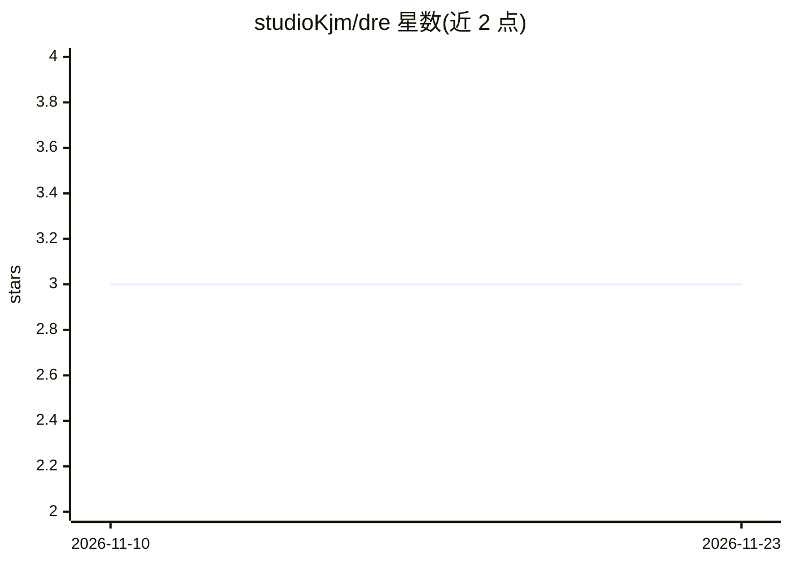

# studioKjm/dre

⭐ 3 · TypeScript · Apache-2.0 · 推送 2026-11-22 · [GitHub](https://github.com/studioKjm/dre) · [官网](https://www.npmjs.com/package/dre-agents) · 个人维护

**为 AI agent 提供目标产品商业/领域分析工具的 MCP 服务器**

以 MCP 服务器形式提供 11 个商业与领域分析工具：从域名出发收集定价、条款、应用商店内购、技术栈、广告库、SEC/DART 财务、价格历史与招聘信息，输出带 observed/inferred/estimated 类型标注、置信度、证据与假设的声明式报告。自身不调用 LLM 或搜索引擎，采用 BYOK 模式由调用方 agent 补充研究；不绕过 robots.txt 与反爬检测。安装命令自动向 Claude Code、Cursor、Gemini CLI、Codex、Grok Build 注册。状态为 pre-release。

## 筛选速览

| 维度 | 判定 | 备注 |
|---|---|---|
| AI 角色 | `ai-ecosystem` | LLM/agent 周边工具 |
| 许可风险 | `permissive` | Apache-2.0 |
| 部署形态 | `library` | 以包/库形式分发 |
| 模型依赖 | — | README 未给出锁定关系 |
| 硬件要求 | — | 无带数字的原话,不猜 |
| 安装摩擦 | `low` | 无编译、无系统依赖或容器化 |
| 成熟度 | `idea` | |

## 能力要点

- 11 个 MCP 工具覆盖定价、条款、技术栈、广告、财务、招聘等采集
- claim schema 区分 observed/inferred/estimated 并附证据与假设
- BYOK：不内置 LLM 调用，不绕过 robots.txt 与反爬检测
- npx setup 自动检测并向多个 agent CLI 注册服务器

## 适用场景

- 用 Claude Code 分析竞品的定价与商业模式并留存证据
- 通过 archive.org 快照追踪目标产品价格变化
- 从 SEC EDGAR 与 DART 获取上市公司收入数据

## 场景标签

`网页抓取` · 领域:效率与自动化

## 证据(README 行号)

> L22: Auto-detects installed agents (Claude Code, Cursor, Gemini CLI, Codex, Grok Build) and
> L23: registers the DRE MCP server with each. Open a new session and the tools below appear
> L49: 3. Works with public sources and your own LLM key (BYOK). No paid data required.

## 星数曲线

2026-11-10 3 → 2026-11-23 3（+0）

---
*卡片 v1 · prompt 1.4 · 生成 2026-11-21 · 置信度 high · 依据 README sha `0612d6f35431` · [字段定义](../../DATASET.md)*
