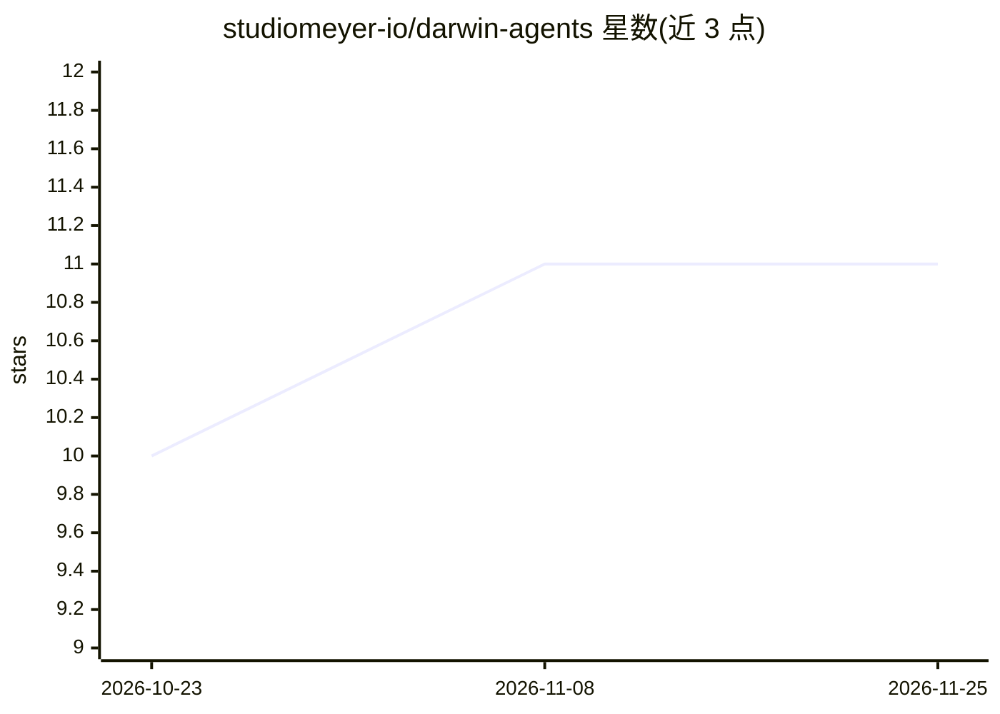

# studiomeyer-io/darwin-agents

⭐ 11 · TypeScript · MIT · 推送 2026-11-09 · [GitHub](https://github.com/studiomeyer-io/darwin-agents) · [官网](https://matthiasmeyer.tech/repos/darwin-agents) · 组织维护

**自动优化自身提示词的 AI agent 构建框架**

TypeScript 框架，用于构建能在运行中自我改进的 AI agent：agent 执行任务后由 Critic agent 评估输出，框架据聚合统计生成改进的提示词变体，经 A/B 测试后把胜出者设为默认。安全门包含回归回滚、数据质量暂停与每次变异的对齐检查；可选启用 GEPA 式反思优化器与 mSPRT/Hoeffding/EB 序贯检验门。通过 npm 安装，使用 better-sqlite3 存储，需配置 Anthropic/OpenAI API key 或 Claude CLI，支持用 defineAgent 自定义 agent。

## 筛选速览

| 维度 | 判定 | 备注 |
|---|---|---|
| AI 角色 | `ai-ecosystem` | LLM/agent 周边工具 |
| 许可风险 | `permissive` | MIT |
| 部署形态 | `library` | 以包/库形式分发 |
| 模型依赖 | locked-api |  |
| 硬件要求 | — | 无带数字的原话,不猜 |
| 安装摩擦 | `low` | 无编译、无系统依赖或容器化 |
| 成熟度 | `idea` | |

## 能力要点

- Critic 评估 + 提示词变体 A/B 测试 + 胜者自动上线的自进化循环
- 安全门：回归回滚、工具故障时暂停进化、每次变异的语义对齐检查
- 可选 GEPA 反思优化器与 mSPRT/Hoeffding/EB 序贯 A/B 检验（v0.15/v0.16 修正）
- 12 行 defineAgent 定义自定义 agent，CLI 运行 darwin run

## 适用场景

- 让内容生成类 agent 的提示词随运行数据持续迭代
- 需要在提示词变更时保留回滚与安全约束的生产 agent
- 对不同提示词变体做带序统计算的在线 A/B 实验

## 场景标签

`提示工程` `Agent 框架` · 领域:Agent 开发

## 证据(README 行号)

> L17: Build AI agent teams that learn from every run. Self-evolving prompts. A/B tested. Safety-gated.
> L39: Darwin is a TypeScript framework for building AI agents that **automatically optimize their own prompts** through e

## 星数曲线

2026-10-23 10 → 2026-11-25 11（+1）

---
*卡片 v1 · prompt 1.4 · 生成 2026-11-18 · 置信度 high · 依据 README sha `b52dd94b53bf` · [字段定义](../../DATASET.md)*
