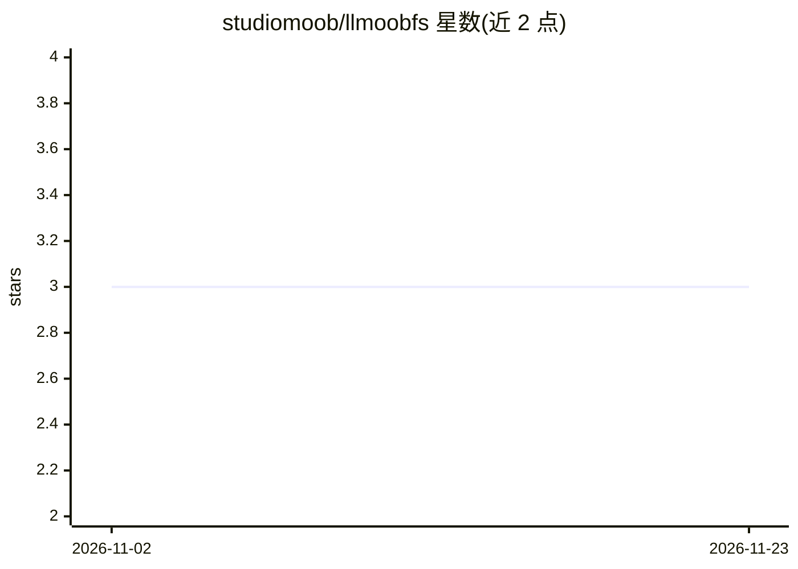

# studiomoob/llmoobfs

⭐ 3 · C · GPL-2.0 · 推送 2026-11-21 · [GitHub](https://github.com/studiomoob/llmoobfs) · [官网](https://studiomoob.github.io/llmoobfs/) · 个人维护 · 中文 README

**面向 LLM agent 记忆的 Linux 内核文件系统模块：内核可查询的存储层**

一个 GPL-2.0 的实验性 Linux 内核模块，无 FUSE、无守护进程，堆叠在 ext4/btrfs/XFS 目录之上：把记忆文件的字段写为带类型检查的 user.moob.* 扩展属性，在内核 RAM 中维护索引，并通过 QUERY2 ioctl 返回经 POSIX 文件权限授权的查询结果（最多四个 AND 条件）。嵌入、排序与提示构建留给应用层。仅在特定 Debian/Ubuntu 内核版本的 VM 中测试，自述为实验项目、不可用于生产，需编译或使用 DKMS 签名包安装。

## 筛选速览

| 维度 | 判定 | 备注 |
|---|---|---|
| AI 角色 | `ai-enhanced` | 去掉 AI 部分产品仍成立 |
| 许可风险 | `viral` | GPL-2.0 |
| 部署形态 | `self-host` | docker 或自建部署 |
| 模型依赖 | — | README 未给出锁定关系 |
| 硬件要求 | — | 无带数字的原话,不猜 |
| 安装摩擦 | `low` | 无编译、无系统依赖或容器化 |
| 成熟度 | `idea` | |

## 能力要点

- typed xattr 属性 + 内核 RAM 索引 + 权限授权的 QUERY2 ioctl 三部分机制
- 移除模块后目录仍是被 grep/getfattr/git/rsync 读取的普通文件树
- 查询只返回该目录内所有可进入者均可读的文件
- 提供 moobfs CLI、C 测试客户端与实验性 Python 库

## 适用场景

- 为跨会话记忆的 agent 存储记忆文件，让操作系统决定谁可见
- 避免在应用侧同步维护文件与第二套索引数据库
- 在 Docker/Podman 容器中给每个 agent 独立的记忆目录
- 从 shell 脚本按 kind 等字段查询文件记录

## 场景标签

`Agent 记忆` · 领域:Agent 开发

## 证据(README 行号)

> L3: **An agent's memory as ordinary files that the kernel can query, with file permissions deciding who sees what.**
> L28: MoobFS is an experimental Linux kernel module (GPL-2.0, no FUSE, no daemon) that stacks over a
> L41: It stores and finds memories. Choosing what is relevant, embeddings, ranking and building the
> L50: **Worth trying or evaluating if** you build an agent memory system, or any program that keeps

## 星数曲线

2026-11-02 3 → 2026-11-23 3（+0）

---
*卡片 v1 · prompt 1.4 · 生成 2026-11-21 · 置信度 high · 依据 README sha `d82a39301ef4` · [字段定义](../../DATASET.md)*
