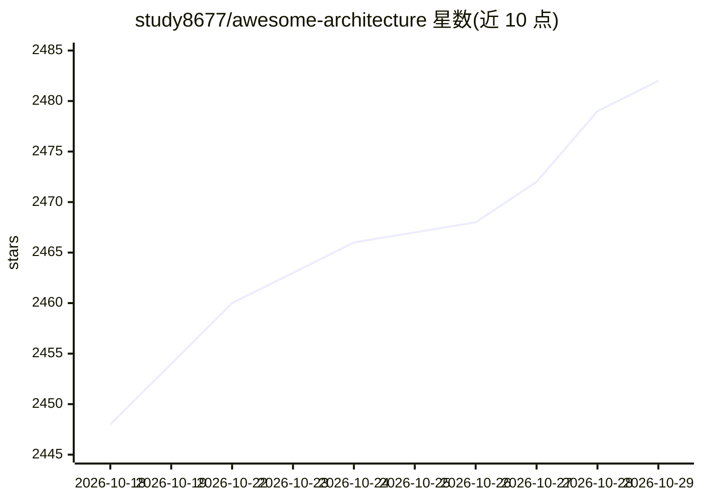

# study8677/awesome-architecture

⭐ 2,482 · Vue · MIT · 推送 2026-09-21 · [GitHub](https://github.com/study8677/awesome-architecture) · [官网](https://study8677.github.io/awesome-architecture/) · 个人维护 · 中文 README

**架构知识库：教程、系统模板与端到端案例，面向架构学习者**

一个专注架构而非代码的开源知识库，由个人维护，提供中英双语在线阅读。内容由三部分组成：tutorial/ 收录 26 个教程章节（架构思维、分布式系统、AI 原生系统设计、技术选型、AI 原生组织、基础模型训练决策等）；templates/ 提供 31 个真实系统架构模板（16 经典 + 5 AI 原生 + 4 AI 编码/自治 Agent + 1 系统提示词 + 5 工业/嵌入式），刻意不讨论语言与框架，每条附真实开源项目链接；cases/ 含 6 个从 0 到上线的端到端案例（抢票、工单 SaaS、企业 RAG、实时协同、内容分发、编码 Agent 平台）。另有社区整理的 EPUB 电子书与配套 architecture-copilot skill。

## 筛选速览

| 维度 | 判定 | 备注 |
|---|---|---|
| AI 角色 | `ai-knowledge` | 知识聚合/清单类 |
| 许可风险 | `permissive` | MIT |
| 部署形态 | `None` |  |
| 模型依赖 | — | README 未给出锁定关系 |
| 硬件要求 | — | 无带数字的原话,不猜 |
| 安装摩擦 | `low` | 无编译、无系统依赖或容器化 |
| 成熟度 | — | 结构信号不足 |

## 能力要点

- 26 个中英双语教程章节，覆盖架构思维到 AI 原生组织
- 31 个真实系统架构模板，每个附开源项目/工程文档链接
- 6 个端到端案例（含企业 RAG、编码 Agent 平台）
- 社区 EPUB 电子书与 architecture-copilot 配套 skill

## 适用场景

- 系统设计面试时按模板系统性复习高频考点
- 设计新系统前找最接近场景的架构地图作起点
- 学习从需求到取舍的完整系统设计方法论

## 场景标签

`教程课程` `精选清单` · 领域:学习与行业

## 证据(README 行号)

> L3: > 一个专注「**架构**」而非「代码」的开源知识库。
> L43: awesome-architecture/
> L152: > 目前共 **31** 个模板(16 经典 / 通用 + 5 AI 原生 + 4 AI 编码 / 自治 Agent + 1 系统提示词架构 + 5 工业 / 嵌入式),每个都在末尾附**真实开源项目 / 工程文档链接**,可顺

## 星数曲线

2026-10-18 2,448 → 2026-10-29 2,482（+34）

---
*卡片 v1 · prompt 1.4 · 生成 2026-10-21 · 置信度 high · 依据 README sha `1888b6a304d2` · [字段定义](../../DATASET.md)*
