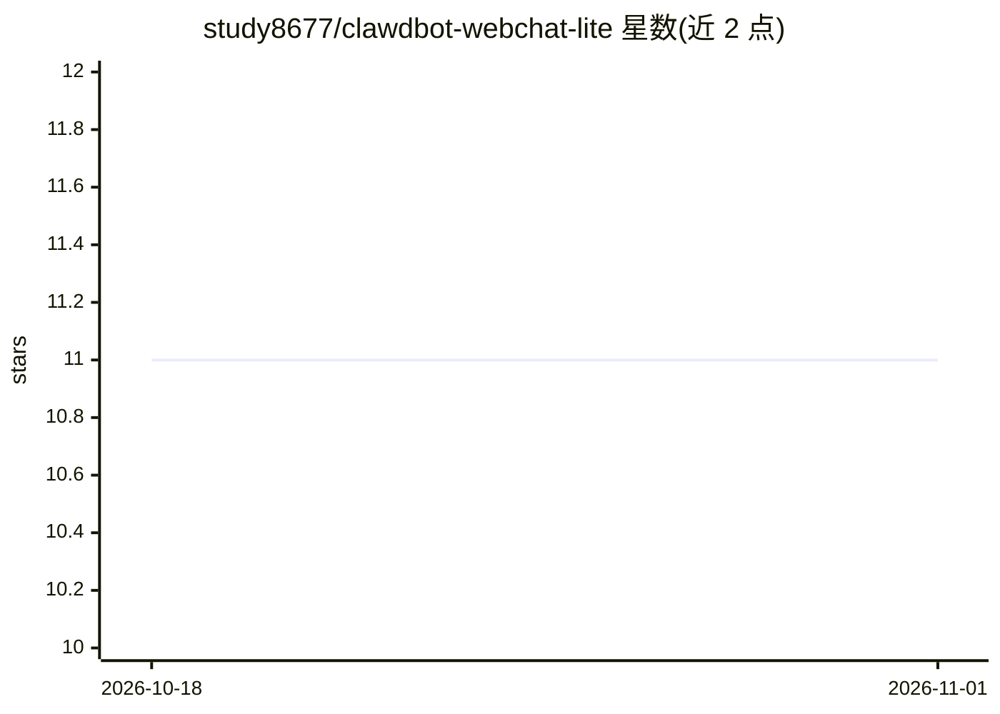

# study8677/clawdbot-webchat-lite

⭐ 11 · TypeScript · 推送 2026-01-26 · [GitHub](https://github.com/study8677/clawdbot-webchat-lite) · 个人维护 · 中文 README

**轻量自部署的 Clawdbot 网页聊天客户端，直连 Gateway WebSocket**

面向 Clawdbot 用户的网页聊天客户端：不创建新 channel，仅通过 Gateway WebSocket 连接，提供会话列表（sessions.list）、消息历史与发送（chat.history / chat.send）、实时 WS 通知和本地保存的认证预设。强调自部署与国内网络环境可用（支持反向代理注入认证 header 或在 WS URL 中携带 token），以最小维护成本为设计原则。通过 npm install 与 npm run dev 本地运行。

## 筛选速览

| 维度 | 判定 | 备注 |
|---|---|---|
| AI 角色 | `ai-ecosystem` | LLM/agent 周边工具 |
| 许可风险 | `none` | — |
| 部署形态 | `library` | 以包/库形式分发 |
| 模型依赖 | — | README 未给出锁定关系 |
| 硬件要求 | — | 无带数字的原话,不猜 |
| 安装摩擦 | `low` | 无编译、无系统依赖或容器化 |
| 成熟度 | — | 结构信号不足 |

## 能力要点

- 直连 Gateway WebSocket，不造新 channel
- 会话列表、消息历史与发送、实时 WS 通知
- 认证预设本地保存，支持反向代理注入 header 或 WS URL 携带 token
- 可自部署、支持反向代理

## 适用场景

- 在国内网络环境下自部署 Clawdbot 聊天界面
- 想要极简开源客户端与多端同步对话的开发者

## 场景标签

`聊天机器人` · 领域:对话与助手

## 证据(README 行号)

> L12: - **连接即价值**：直连 Gateway WS，避免中间层与复杂依赖。
> L31: - 客户端直接连接 Gateway WebSocket。

## 星数曲线

2026-10-18 11 → 2026-11-01 11（+0）

---
*卡片 v1 · prompt 1.4 · 生成 2026-11-01 · 置信度 high · 依据 README sha `8079e741de27` · [字段定义](../../DATASET.md)*
