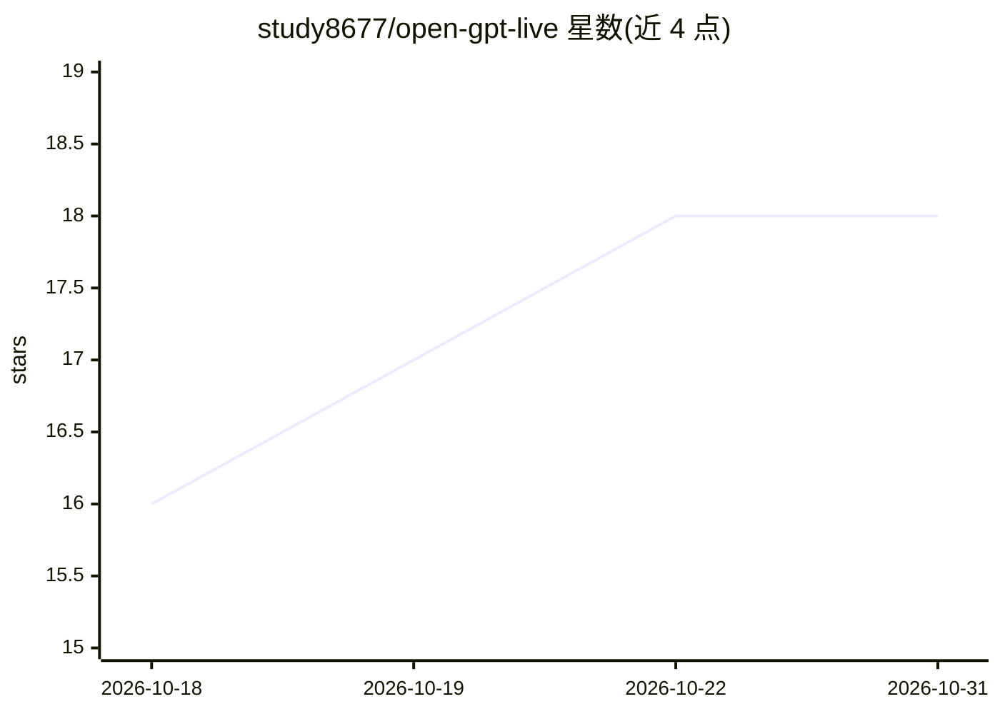

# study8677/open-gpt-live

⭐ 18 · TypeScript · MIT · 推送 2026-07-10 · [GitHub](https://github.com/study8677/open-gpt-live) · 个人维护 · 中文 README

**自托管实时语音 AI 会话层：浏览器语音对话可打断、可观测**

面向开发者的可自托管实时语音 AI 参考实现：浏览器端麦克风采集、自适应 RMS VAD（含噪声校验与 400ms PCM 预滚）、流式 STT、流式 LLM 回复与按句分段的 TTS 播放，全部通过可检视的 TypeScript WebSocket 协议编排。LLM/STT/TTS 位于可替换的 provider 适配器之后，默认路径为 OpenAI 兼容 API；实验性 Docker 本地配置使用 Ollama 与 faster-whisper/Kokoro。限制：会话历史仅存于当前连接、不含鉴权计费多租户、Chromium 为已验证浏览器基线。

## 筛选速览

| 维度 | 判定 | 备注 |
|---|---|---|
| AI 角色 | `ai-native` | 本体是模型或模型工具 |
| 许可风险 | `permissive` | MIT |
| 部署形态 | `self-host` | docker 或自建部署 |
| 模型依赖 | local-ok | 支持本地模型 |
| 硬件要求 | — | 无带数字的原话,不猜 |
| 安装摩擦 | `low` | 无编译、无系统依赖或容器化 |
| 成熟度 | `idea` | |

## 能力要点

- 打字机式语音回路：实时转写、流式 LLM、可打断 TTS
- 浏览器与网关行为由共享 TypeScript 事件协议描述，可检视可替换
- LLM/批式 STT/流式 STT/TTS 均在 provider 接口之后可替换
- 逐轮延迟与 VAD 诊断面板（首转写/首 token/首音频/噪声底）

## 适用场景

- 自托管一个可打断的浏览器语音对话应用
- 研究/调优实时语音会话的延迟与打断机制
- 以本地 Ollama + faster-whisper + Kokoro 跑无云 key 的语音回路

## 场景标签

`语音 Agent` · 领域:对话与助手

## 证据(README 行号)

> L7:  An open voice-AI session layer that can listen, speak, and be interrupted.
> L36: OpenGPT Live is a self-hostable realtime voice AI reference implementation for the session layer between browser au
> L42: |Text chat|Stable|Typed WebSocket messages and streamed Chat Completions output.|

## 星数曲线

2026-10-18 16 → 2026-10-31 18（+2）

---
*卡片 v1 · prompt 1.4 · 生成 2026-10-29 · 置信度 high · 依据 README sha `d1d0dcbfb979` · [字段定义](../../DATASET.md)*
