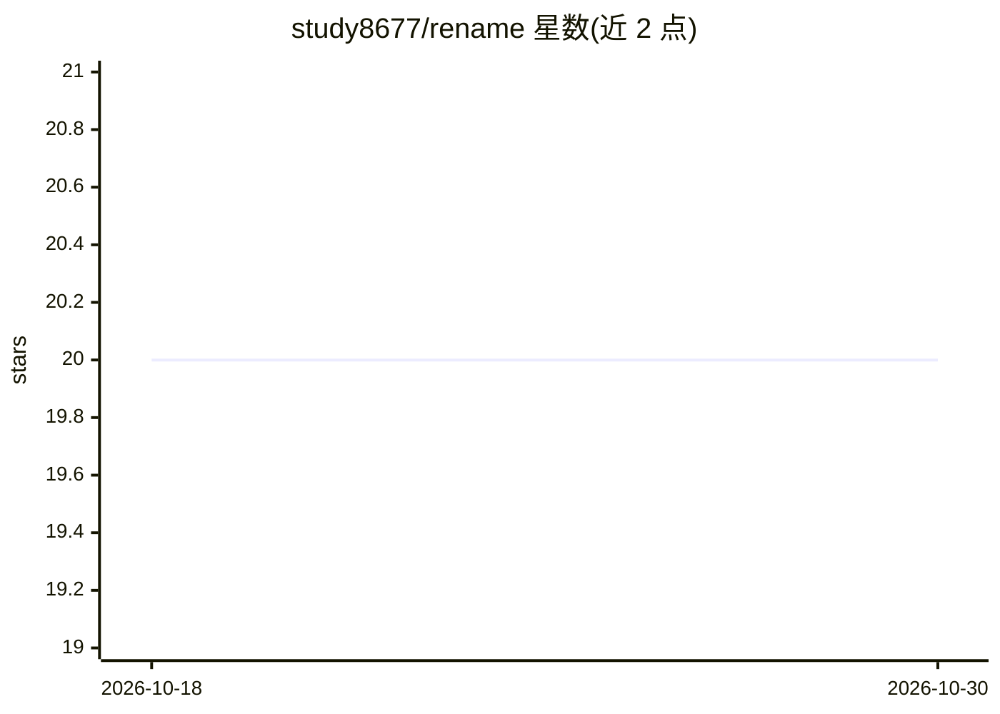

# study8677/rename

⭐ 20 · Python · MIT · 推送 2026-08-19 · [GitHub](https://github.com/study8677/rename) · [官网](https://github.com/study8677/rename) · 个人维护 · 中文 README

**给 Claude Code/Codex/Cursor 等 8 种 AI 编程会话自动改名与跨工具搜索的 CLI**

后台守护进程定期扫描本地 AI 编程工具的会话存储，对空闲且有新内容的会话用 LLM 生成新标题写回；标题生成默认复用已登录的 claude/codex CLI（无需 API key），也可走 Anthropic/OpenAI 直连或纯离线启发式。支持 Claude Code、Codex、Cursor、Antigravity 等 8 种工具，其中 5 种标注实验性；提供 rename search 跨工具按标题/正文搜索，附带 macOS 原生与跨平台 PySide6 两个可选 GUI。首次运行记基线时间戳，旧会话默认不改；只写标题字段，不编辑对话内容。

## 筛选速览

| 维度 | 判定 | 备注 |
|---|---|---|
| AI 角色 | `ai-ecosystem` | LLM/agent 周边工具 |
| 许可风险 | `permissive` | MIT |
| 部署形态 | `library` | 以包/库形式分发 |
| 模型依赖 | — | README 未给出锁定关系 |
| 硬件要求 | — | 无带数字的原话,不猜 |
| 安装摩擦 | `low` | 无编译、无系统依赖或容器化 |
| 成熟度 | `idea` | |

## 能力要点

- 读取 8 种 AI 编程工具的本地会话存储并改写标题（5 种为实验性）
- 默认复用已登录 claude/codex CLI 生成标题，无需 API key，可退回离线启发式
- rename search 跨工具按标题与正文搜索历史会话
- 基线时间戳保护旧会话，操作幂等且不修改对话内容

## 适用场景

- 让侧边栏里过时的 AI 会话标题跟随实际工作内容更新
- 跨 Claude Code/Codex/Cursor 等工具搜索找不回的历史对话
- 用菜单栏/托盘 GUI 查看各工具会话状态并手动触发改名

## 场景标签

 · 领域:开发者工具/AI 会话管理

## 证据(README 行号)

> L17: `rename` 在后台运行。会话一空闲下来,它就把标题改成这次工作真正变成的样子;
> L93: **标题是怎么来的。** 默认 rename 会调用你已经登录的 `claude`（或 `codex`）命令行
> L113: |工具|读取|写入|状态|

## 星数曲线

2026-10-18 20 → 2026-10-30 20（+0）

---
*卡片 v1 · prompt 1.4 · 生成 2026-10-28 · 置信度 mid · 依据 README sha `c8493f8f34a6` · [字段定义](../../DATASET.md)*
