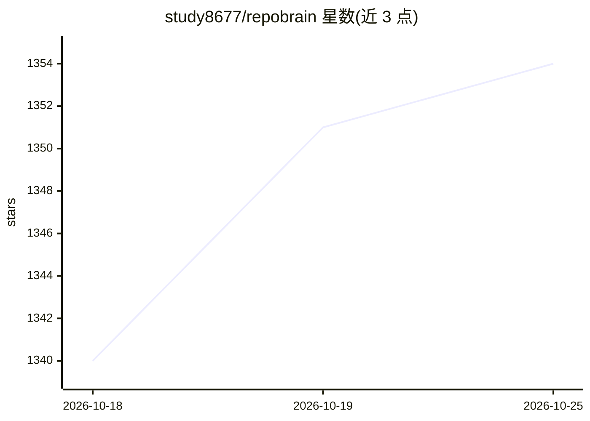

# study8677/repobrain

⭐ 1,355 · Python · MIT · 推送 2026-10-23 · [GitHub](https://github.com/study8677/repobrain) · [官网](https://deepwiki.com/study8677/antigravity-workspace-template) · 个人维护 · 中文 README

**跨 IDE 仓库知识引擎：为代码问答提供带出处上下文**

面向开发者的仓库知识引擎：`rb-refresh` 部署多 Agent 集群，按模块自主学习代码并生成知识文档，存于项目内 `.repobrain/` 目录；`rb-ask` 将问题路由到对应模块 Agent，返回带文件路径与行号的回答。知识层可被 Claude Code、Codex CLI、Cursor、Windsurf 等多种 IDE/Agent 共享，通过斜杠命令、共享上下文文件、CLI 或 MCP 接入。后端支持已登录的无头 CLI（如 Trae）或 OpenAI 兼容 API；要求 Python 3.10+ 与至少一次提交的 Git 仓库，大型仓库首次构建可能耗时数分钟。

## 筛选速览

| 维度 | 判定 | 备注 |
|---|---|---|
| AI 角色 | `ai-ecosystem` | LLM/agent 周边工具 |
| 许可风险 | `permissive` | MIT |
| 部署形态 | `None` |  |
| 模型依赖 | — | README 未给出锁定关系 |
| 硬件要求 | — | 无带数字的原话,不猜 |
| 安装摩擦 | `low` | 无编译、无系统依赖或容器化 |
| 成熟度 | — | 结构信号不足 |

## 能力要点

- 多 Agent 分模块生成仓库知识库，存于项目内 `.repobrain/` 目录
- `rb-ask` 路由问题到对应模块 Agent，回答带文件路径与行号
- 同一知识层跨 Claude Code、Codex、Cursor、Windsurf 等 IDE 共享
- 支持无 API key 的无头 CLI 后端或 OpenAI 兼容 API，更新失败保留可用旧版

## 适用场景

- 上手陌生代码库时直接提问并得到带出处的回答
- 为 Claude Code / Codex 等编程 Agent 提供仓库级上下文
- 多 IDE 间共享同一份项目知识库与编码约定

## 场景标签

`多智能体` `RAG` · 领域:Agent 开发

## 证据(README 行号)

> L5: Cross-IDE repository knowledge engine for grounded codebase Q&A.
> L28: **Cross-IDE repository knowledge engine for grounded codebase Q&A.** Same `.repobrain/` knowledge layer reads in ev
> L32: `rb-refresh` deploys a multi-agent cluster that autonomously reads your code — each module gets its own Agent that 

## 星数曲线

2026-10-18 1,340 → 2026-10-25 1,354（+14）

---
*卡片 v1 · prompt 1.4 · 生成 2026-10-21 · 置信度 high · 依据 README sha `214c7f423c6c` · [字段定义](../../DATASET.md)*
