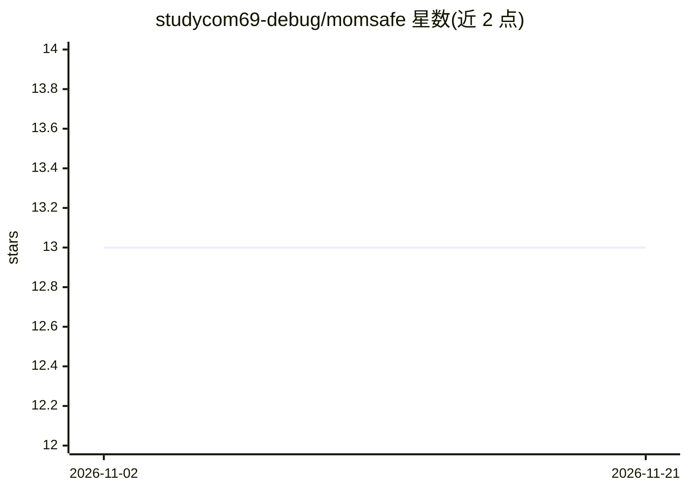

# studycom69-debug/momsafe

⭐ 13 · TypeScript · 推送 2026-10-30 · [GitHub](https://github.com/studycom69-debug/momsafe) · [官网](https://momsafe.in) · 个人维护

**面向孕妇的持续健康监测平台：可穿戴体征采集、风险评分与就医定位**

MomSafe AI 是孕期母婴健康平台，由四部分组成：自研 ESP32-S3 腕带（PPG 传感器采集心率/血氧/HRV，BLE 5.0 上传）、React 19 + Supabase 的实时体征仪表盘、基于确定性临床规则生成风险分层的 Maternal Risk Index 引擎（声明不使用无约束生成式文本）、以及基于 OpenStreetMap 的急诊医院定位与一键 SOS。README 提供仪表盘本地运行步骤，硬件 PCB 仍在路线图未完成阶段，且声明为非认证医疗诊断设备。

## 筛选速览

| 维度 | 判定 | 备注 |
|---|---|---|
| AI 角色 | `ai-enhanced` | 去掉 AI 部分产品仍成立 |
| 许可风险 | `none` | — |
| 部署形态 | `library` | 以包/库形式分发 |
| 模型依赖 | — | README 未给出锁定关系 |
| 硬件要求 | — | 无带数字的原话,不猜 |
| 安装摩擦 | `low` | 无编译、无系统依赖或容器化 |
| 成熟度 | `idea` | |

## 能力要点

- Maternal Risk Index 多参数风险分层，输出 Optimal/Advisory/Elevated/Critical 分级
- 确定性临床规则驱动，非生成式文本输出指导卡片
- 孕早/中/晚期自适应生理基线安全区
- 地理定位产科/NICU 医院发现与一键紧急呼叫

## 适用场景

- 孕期持续监测心率、血氧、血压等体征趋势
- 记录孕期营养、用药与胎动
- 紧急情况下查找附近产科医院并导航

## 场景标签

 · 领域:医疗健康/母婴

## 证据(README 行号)

> L80: ### 🧠 3. Maternal Risk Index (MRI)™ (Clinical AI Engine)
> L83: - **Zero-Hallucination Directives**: Uses deterministic, evidence-based clinical rules rather than unconstrained ge
> L219: > **MomSafe AI is an informational health monitoring assistive platform.**

## 星数曲线

2026-11-02 13 → 2026-11-21 13（+0）

---
*卡片 v1 · prompt 1.4 · 生成 2026-11-18 · 置信度 mid · 依据 README sha `9de2822bef31` · [字段定义](../../DATASET.md)*
