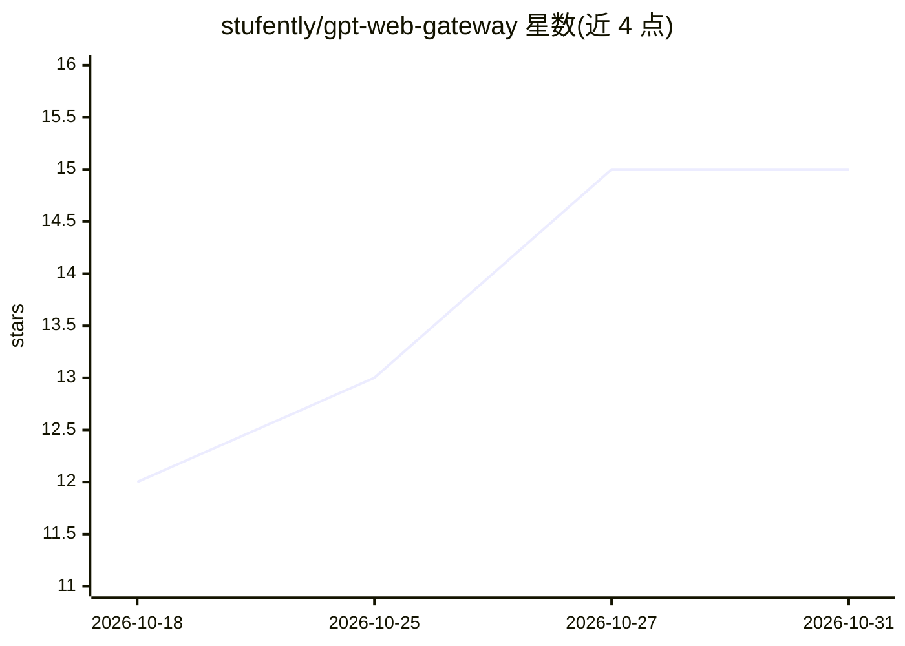

# stufently/gpt-web-gateway

⭐ 15 · JavaScript · MIT · 推送 2026-10-30 · [GitHub](https://github.com/stufently/gpt-web-gateway) · [官网](https://stufently.github.io/gpt-web-gateway/) · 个人维护

**把 ChatGPT 网页会话封装成 OpenAI 兼容 API 的自托管网关**

用 patchright（Playwright 补丁分支）驱动真实 Chrome 登录 ChatGPT.com 网页，将其暴露为 OpenAI 兼容的 REST 端点：chat completions（含 thinking 模式与流式 SSE）、Responses 端点、图像生成与编辑（multipart 上传、参考图、批量至 10）。带远程登录 UI（截图流式传输，支持 SSO/2FA）或环境变量自动登录，会话持久化。运维层面提供请求队列、类型化错误、Prometheus 指标、卡死检测与浏览器自愈重置；applied/requested 回显块供客户端检测 UI 静默降级。README 明确警告：自动化网页 UI 违反 OpenAI 使用条款，可能导致封号，需用专用订阅账号。

## 筛选速览

| 维度 | 判定 | 备注 |
|---|---|---|
| AI 角色 | `ai-ecosystem` | LLM/agent 周边工具 |
| 许可风险 | `permissive` | MIT |
| 部署形态 | `self-host` | docker 或自建部署 |
| 模型依赖 | — | README 未给出锁定关系 |
| 硬件要求 | — | 无带数字的原话,不猜 |
| 安装摩擦 | `low` | 无编译、无系统依赖或容器化 |
| 成熟度 | — | 结构信号不足 |

## 能力要点

- 真实浏览器驱动 ChatGPT 网页 UI，选择器带 EN/RU 多重回退
- 图像生成与编辑（参考图、批量至 10、宽高比）走 Plus 用户同一 UI
- thinking 模式映射到 intelligence 选择器，Pro 配额耗尽时自动降档并回显差异
- 请求队列、Prometheus 指标、卡死检测与自愈浏览器重置

## 适用场景

- 把已有的 ChatGPT Plus/Pro 订阅当作 OpenAI 兼容 API 供自己的工具调用
- 在无头服务器上通过远程登录 UI 完成 SSO/2FA 登录并持久化会话
- 需要图像生成/编辑与 thinking 模式的自托管场景（接受封号风险）

## 场景标签

`模型网关` · 领域:Agent 开发

## 证据(README 行号)

> L3: OpenAI-compatible API gateway backed by the **ChatGPT.com web UI**. A headless
> L5: it as familiar REST endpoints: chat completions (with thinking modes), image

## 星数曲线

2026-10-18 12 → 2026-10-31 15（+3）

---
*卡片 v1 · prompt 1.4 · 生成 2026-10-30 · 置信度 high · 依据 README sha `77568ca67d89` · [字段定义](../../DATASET.md)*
