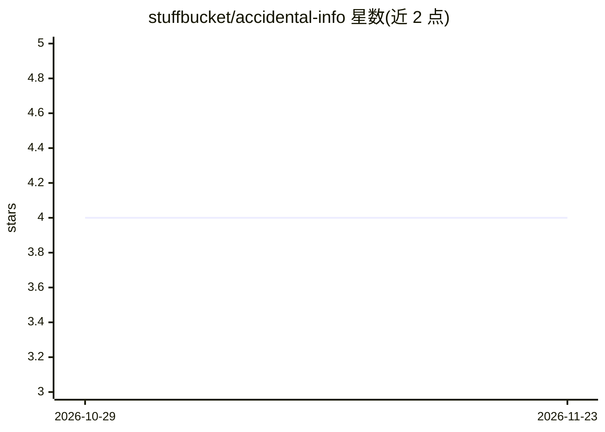

# stuffbucket/accidental-info

⭐ 4 · Python · MIT · 推送 2026-11-14 · [GitHub](https://github.com/stuffbucket/accidental-info) · [官网](https://accidental.info) · 个人维护

**面向团队开发者的 AI 编码代理短篇指南合集**

以仓库形式维护的一组口袋指南，每篇回答一个问题，覆盖 AI 编码系统、团队规范与审查、软件工厂、决策模型等主题；草稿区包含 Claude Code/Codex/Copilot CLI 配置位置、MCP、上下文窗口等条目，以及象棋、家务等非技术主题。每篇由人工撰写审查，AI 承担检索与初稿等杂务。指南以站点、PDF 和 Word 形式发布，仓库用 pnpm/Turborepo 构建，PDF 哈希锁定版式一致性。

## 筛选速览

| 维度 | 判定 | 备注 |
|---|---|---|
| AI 角色 | `ai-knowledge` | 知识聚合/清单类 |
| 许可风险 | `permissive` | MIT |
| 部署形态 | `library` | 以包/库形式分发 |
| 模型依赖 | — | README 未给出锁定关系 |
| 硬件要求 | — | 无带数字的原话,不猜 |
| 安装摩擦 | `low` | 无编译、无系统依赖或容器化 |
| 成熟度 | — | 结构信号不足 |

## 能力要点

- 每篇指南回答一个问题，统一术语，带语义化版本号
- PDF 为确定性构建，哈希校验保证输出一致
- 站点（Astro/Starless/Starlight 系）+ PDF + Word 三种交付形式
- 编辑流程拆为 6 个 skill 管理规划、撰写、审查

## 适用场景

- 团队内统一 AI 编码代理的术语与协作规范
- 了解各编码代理配置文件的存放位置
- 作为软件工厂/代理化交付流程的入门读物

## 场景标签

`编码 Agent` `教程课程` · 领域:编码与开发

## 证据(README 行号)

> L3: Short guides to AI coding agents and the ways teams use them to build software. Each one
> L7: A person writes and reviews every guide. AI does the grunt work: finding sources, rough
> L17: |Accidental Intelligence|A pocket-sized guide to the Accidental Guides, as of October 2026.|0.4.1|PDF · Word|

## 星数曲线

2026-10-29 4 → 2026-11-23 4（+0）

---
*卡片 v1 · prompt 1.4 · 生成 2026-11-21 · 置信度 high · 依据 README sha `0dfa2c46b3f5` · [字段定义](../../DATASET.md)*
