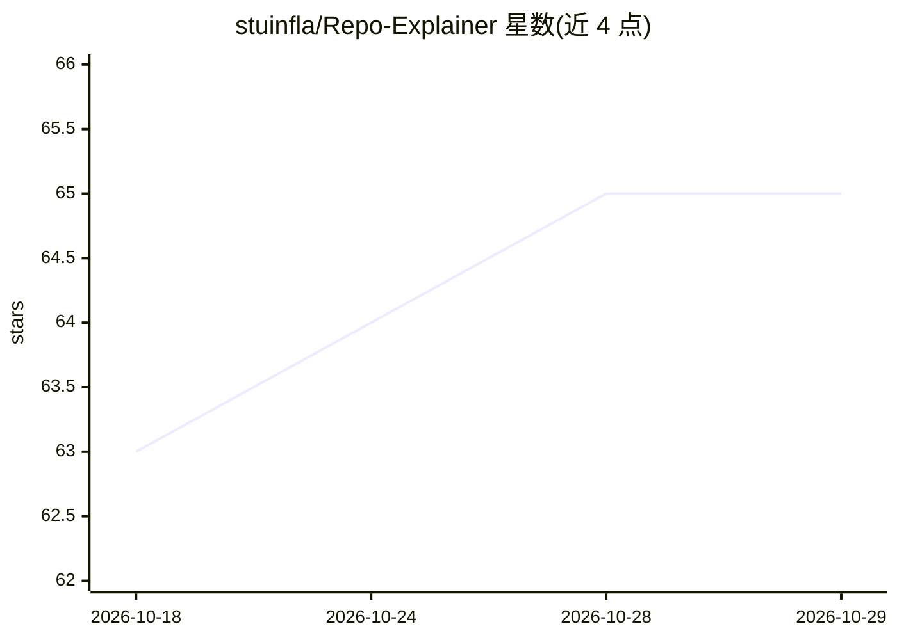

# stuinfla/Repo-Explainer

⭐ 65 · JavaScript · 推送 2026-10-16 · [GitHub](https://github.com/stuinfla/Repo-Explainer) · [官网](https://repo-explainer-six.vercel.app) · 个人维护

**把任意 GitHub 仓库自动生成可视化讲解页的工具**

输入一个 GitHub 仓库 URL，产出三件产物：可分享的讲解网页（含基于真实依赖图的架构图与数据流图、定制动效 SVG）、一个邀请协作者的讲解仓库、以及含向量知识库/搜索 CLI/MCP server 的 AI 知识包。核心为一个 Claude Code skill，流程含克隆仓库、多模型竞稿、构建 384 维本地嵌入向量库、撰写文案、可视化、浏览器截图双维度评分质检门（未达分数线拒绝部署），并有跨构建的学习回写。提供托管网站（公共仓库零配置）、npx CLI（私有仓库自带 key）与 Claude Code 插件三种入口。

## 筛选速览

| 维度 | 判定 | 备注 |
|---|---|---|
| AI 角色 | `ai-native` | 本体是模型或模型工具 |
| 许可风险 | `none` | — |
| 部署形态 | `desktop` | 安装包/桌面程序 |
| 模型依赖 | locked-api |  |
| 硬件要求 | — | 无带数字的原话,不猜 |
| 安装摩擦 | `low` | 无编译、无系统依赖或容器化 |
| 成熟度 | — | 结构信号不足 |

## 能力要点

- 一条命令产出讲解页 + 可编辑仓库 + AI 知识包（向量库/搜索 CLI/MCP server）
- 三模型竞稿选出视觉概念，独立评审打分
- 双设备截图 + 六个操作者问题的质量门，低于分数线在部署边界拒绝发布
- 构建结果与读者评分回写学习存储，改进沉淀进 skill

## 适用场景

- 为开源仓库生成面向陌生读者的可视化介绍页
- 给 Claude Code / Cursor 提供基于真实源码的向量知识库，减少猜测
- 让 AI 编程助手回答关于本仓库的问题时有据可查

## 场景标签

`AI 写作` `RAG` · 领域:内容生成

## 证据(README 行号)

> L42: 3. **A downloadable AI knowledge pack** — a drop-in `.zip` containing a vector knowledge base of the repo, a search
> L100: The judgment lives in **one** place — a Claude Code skill. The same core is exposed through three thin adapters th

## 星数曲线

2026-10-18 63 → 2026-10-29 65（+2）

---
*卡片 v1 · prompt 1.4 · 生成 2026-10-24 · 置信度 high · 依据 README sha `6b761cce22b7` · [字段定义](../../DATASET.md)*
