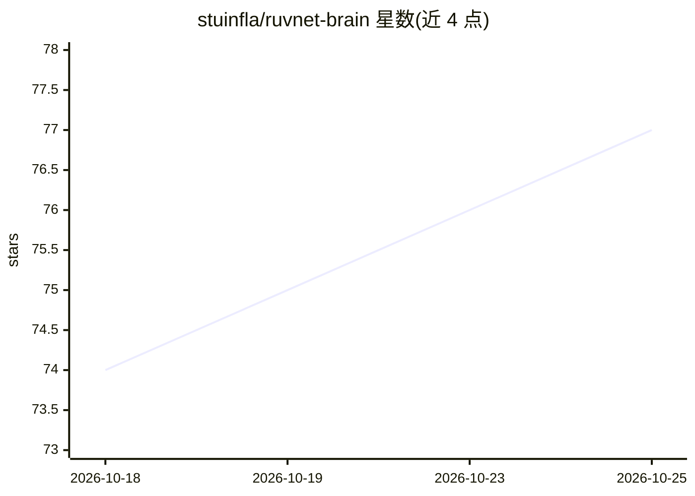

# stuinfla/ruvnet-brain

⭐ 77 · JavaScript · NOASSERTION · 推送 2026-10-24 · [GitHub](https://github.com/stuinfla/ruvnet-brain) · [官网](https://isovision.ai/ruvnet-brain/) · 个人维护

**给 Claude Code/Codex 的 RuvNet 生态源码检索知识包与 MCP 工具**

面向使用 Reuven Cohen 的 RuvNet 技术栈（Ruflo、RuVector/RVF、AgentDB、SPARC 等）的开发者：将公开源码与文档索引为本地知识包，通过 search_ruvnet MCP 工具、技能与生命周期钩子接入 Claude Code 和 Codex，让编码助手基于真实源码回答而非凭记忆的 API。含本地控制台 RNBC 检查环境与协调更新。本地检索不依赖外部 embedding API；知识为快照，覆盖仅限已索引的公开仓库，通过 npx 安装器部署。

## 筛选速览

| 维度 | 判定 | 备注 |
|---|---|---|
| AI 角色 | `ai-ecosystem` | LLM/agent 周边工具 |
| 许可风险 | `none` | NOASSERTION |
| 部署形态 | `library` | 以包/库形式分发 |
| 模型依赖 | — | README 未给出锁定关系 |
| 硬件要求 | — | 无带数字的原话,不猜 |
| 安装摩擦 | `low` | 无编译、无系统依赖或容器化 |
| 成熟度 | — | 结构信号不足 |

## 能力要点

- search_ruvnet MCP 工具返回带仓库/路径标签的源码证据
- 本地知识包（4.6.2 基线：205 个公开存储、165,153 个源码分块）
- 支持 Claude Code 与 Codex 原生插件与钩子
- RNBC 控制台检查安装环境，协调更新器统一管理工具更新

## 适用场景

- 在 Claude Code/Codex 中查找 RuvNet 生态合适的构建模块及其 API 实现
- 让编码助手引用真实源码解释机制，区分设计与实现
- 项目工作流中记录与召回有证据的上下文

## 场景标签

`RAG` · 领域:知识与检索

## 证据(README 行号)

> L46: - **A coding companion** delivered through native Claude Code and Codex plugins: the
> L47:  `search_ruvnet` MCP tool, skills and lifecycle hooks that encourage source-grounded work.
> L124: Public source is indexed into local RVF stores. At query time, the reader combines routing

## 星数曲线

2026-10-18 74 → 2026-10-25 77（+3）

---
*卡片 v1 · prompt 1.4 · 生成 2026-10-24 · 置信度 high · 依据 README sha `27c8ec9cadec` · [字段定义](../../DATASET.md)*
