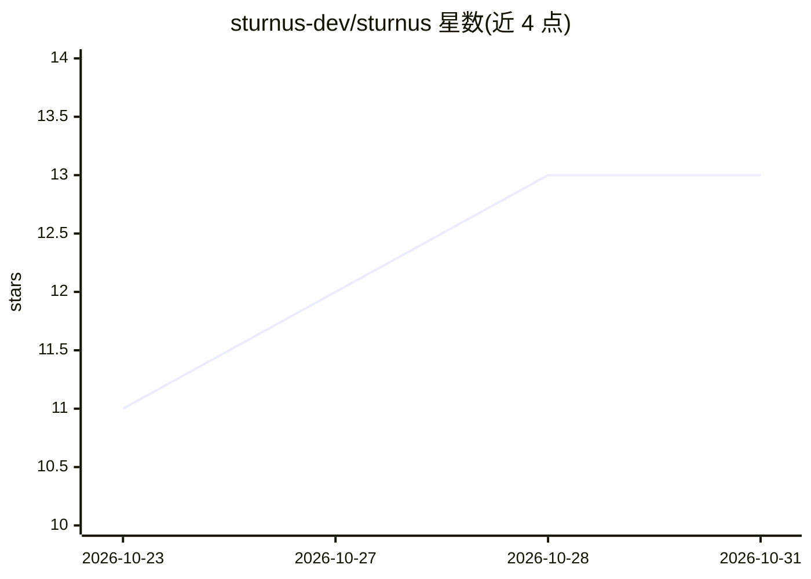

# sturnus-dev/sturnus

⭐ 13 · Rust · MIT · 推送 2026-10-23 · [GitHub](https://github.com/sturnus-dev/sturnus) · [官网](https://sturnus.dev) · 组织维护

**LLM 多供应商延迟感知负载均衡 sidecar，OpenAI 兼容代理**

以单一静态二进制（Rust）部署的 sidecar 代理：暴露 OpenAI 兼容 API，将请求按各候选供应商的延迟 EWMA 与成功率加权路由到最快可用者，支持 OpenAI、Azure OpenAI、Vertex AI、Anthropic、Groq 等，Vertex 支持 GKE Workload Identity 认证与计费标签注入。仅重写 model 字段，请求体逐字节透传，SSE 响应原样转发；提供无状态会话亲和（x-session-affinity 头）、Prometheus 指标与结构化日志。刻意不做请求级重试与成本/质量路由。

## 筛选速览

| 维度 | 判定 | 备注 |
|---|---|---|
| AI 角色 | `ai-ecosystem` | LLM/agent 周边工具 |
| 许可风险 | `permissive` | MIT |
| 部署形态 | `self-host` | docker 或自建部署 |
| 模型依赖 | — | README 未给出锁定关系 |
| 硬件要求 | — | 无带数字的原话,不猜 |
| 安装摩擦 | `low` | 无编译、无系统依赖或容器化 |
| 成熟度 | — | 结构信号不足 |

## 能力要点

- 延迟与错误感知路由：EWMA 加权，恢复的供应商自动赢回流量
- 单一静态二进制，无 Redis/数据库/控制平面依赖
- 内存有界：超预算请求以 429+Retry-After 溢出而非 OOM
- Vertex AI GKE Workload Identity 认证与计费归属标签注入

## 适用场景

- 多 LLM 供应商环境中按实时延迟自动切换流量
- Kubernetes 中以原生 sidecar 方式部署 LLM 网关
- 多轮对话通过会话亲和固定到同一供应商

## 场景标签

`模型网关` · 领域:Agent 开发

## 证据(README 行号)

> L9: LLM providers have variable latency and availability that can break production features. sturnus is a lightweight si
> L50: - **Latency- and error-aware routing** — the fastest healthy provider gets the bulk of traffic, while slower or err

## 星数曲线

2026-10-23 11 → 2026-10-31 13（+2）

---
*卡片 v1 · prompt 1.4 · 生成 2026-10-31 · 置信度 high · 依据 README sha `c095bd5f8d5f` · [字段定义](../../DATASET.md)*
