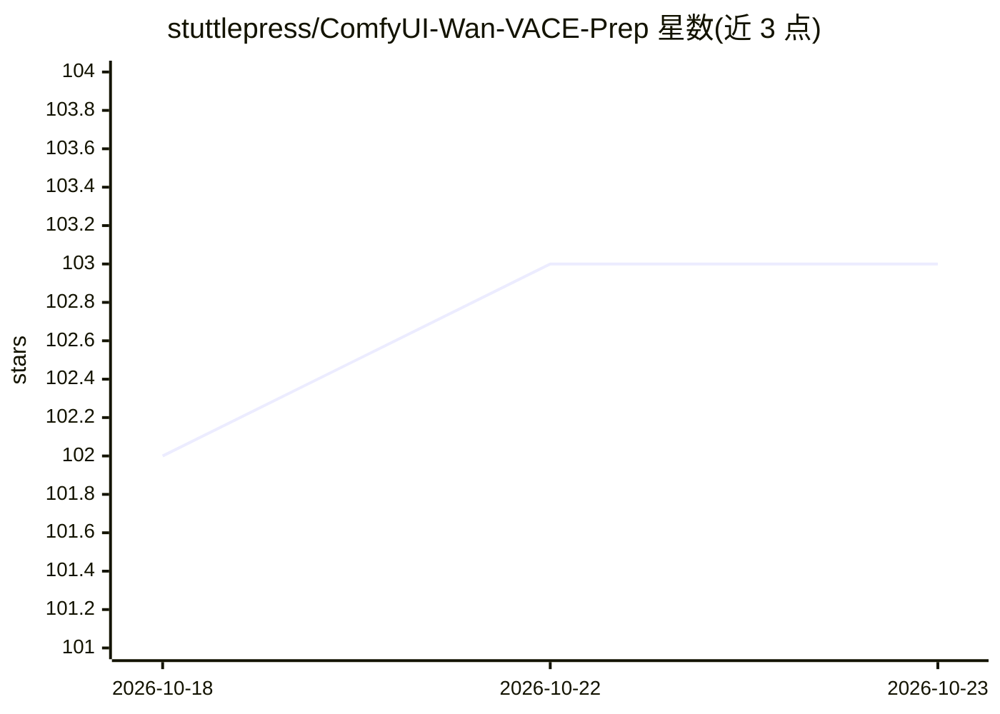

# stuttlepress/ComfyUI-Wan-VACE-Prep

⭐ 103 · Python · MIT · 推送 2026-09-30 · [GitHub](https://github.com/stuttlepress/ComfyUI-Wan-VACE-Prep) · 个人维护

**ComfyUI 节点集：为 Wan VACE 等视频生成模型准备编辑控制输入**

一组 ComfyUI 自定义节点，为常见视频编辑任务生成 VACE 控制视频与控制掩码，供 Wan VACE 等视频生成模型消费，主要覆盖视频外绘（outpaint）、两段视频平滑拼接（VACE Join/Join Batch）、任意帧位置延长（VACE Extend）、批量迭代上下文与文件夹视频加载。外绘节点提供交互式画布，按目标模型（Wan/LTX-2/MiniMax H3）自动设置量化网格与填充色。v1.1.0 起迁移到 ComfyUI Nodes 2.0 API，部分节点依赖未公开文档的接口契约，README 自述在 ComfyUI 更新时可能失效。

## 筛选速览

| 维度 | 判定 | 备注 |
|---|---|---|
| AI 角色 | `ai-ecosystem` | LLM/agent 周边工具 |
| 许可风险 | `permissive` | MIT |
| 部署形态 | `None` |  |
| 模型依赖 | — | README 未给出锁定关系 |
| 硬件要求 | — | 无带数字的原话,不猜 |
| 安装摩擦 | `low` | 无编译、无系统依赖或容器化 |
| 成熟度 | `idea` | |

## 能力要点

- 交互式画布的 Video Outpaint 节点，按模型自动对齐量化网格与填充色
- VACE Join/Join Batch 生成两段视频间的过渡控制（上下文帧/替换帧/新帧参数）
- VACE Extend 从任意帧位置延长视频，VACE Batch Context 支持批量与无缝循环模式
- 无需外部依赖的文件夹视频批量加载节点，可配合 VideoHelperSuite 分块处理

## 适用场景

- 用 Wan VACE 或 LTX-2 对视频做外绘、拼接过渡或延长
- 批量处理多段视频并生成首尾衔接的循环成片
- 在 ComfyUI 工作流中生成对齐模型网格的 VACE 控制输入

## 场景标签

 · 领域:AI 视频/ComfyUI 工具

## 证据(README 行号)

> L3: A small collection of ComfyUI nodes for common video tasks. Primarily designed for Wan VACE, with LTX-2 outpainting 
> L29: Prepares a video for outpainting using an interactive canvas widget. Position and size an output window over your s
> L72: ### VACE Join

## 星数曲线

2026-10-18 102 → 2026-10-23 103（+1）

---
*卡片 v1 · prompt 1.4 · 生成 2026-10-23 · 置信度 high · 依据 README sha `bf4d378bebb6` · [字段定义](../../DATASET.md)*
