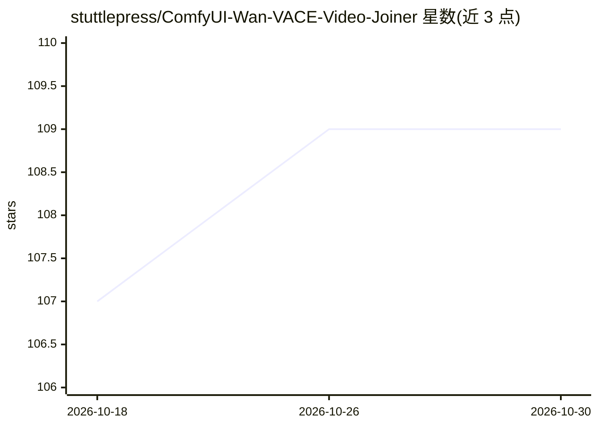

# stuttlepress/ComfyUI-Wan-VACE-Video-Joiner

⭐ 109 · MIT · 推送 2026-04-11 · [GitHub](https://github.com/stuttlepress/ComfyUI-Wan-VACE-Video-Joiner) · 个人维护

**用 Wan VACE 生成转场帧、自动拼接视频片段的 ComfyUI 工作流**

面向 ComfyUI 用户的工作流集合：指向一个视频片段目录，在每处衔接由 Wan VACE 按两侧上下文生成新帧替换接缝，并修复片段边界的噪点帧。支持 Wan 2.1 VACE 或 Wan 2.2 Fun VACE，输入片段可来自 Wan、LTX-2、手机拍摄或素材库等任意来源，支持循环输出与 GGUF 量化模型；推理隔离在 Sampler 子图中可替换。依赖五个自定义节点包（可经 Manager 安装），每个转场需手动排队一次；已记录 Wan 2.1 下重影、色彩偏移等已知限制及对策。

## 筛选速览

| 维度 | 判定 | 备注 |
|---|---|---|
| AI 角色 | `ai-native` | 本体是模型或模型工具 |
| 许可风险 | `permissive` | MIT |
| 部署形态 | `None` |  |
| 模型依赖 | — | README 未给出锁定关系 |
| 硬件要求 | — | 无带数字的原话,不猜 |
| 安装摩擦 | `low` | 无编译、无系统依赖或容器化 |
| 成熟度 | — | 结构信号不足 |

## 能力要点

- 转场处按两侧上下文生成新帧替换接缝
- 兼容 Wan 2.1/2.2 Fun VACE（bf16/fp16/fp8/GGUF）
- 输入片段不限来源（任意模型生成或实拍素材）
- 推理隔离在 Sampler 子图，可替换为自定义配置

## 适用场景

- 把多段 AI 生成视频或实拍片段拼接为连贯成片
- 为视频制作平滑的自然过渡转场
- 生成可无缝循环的视频结果

## 场景标签

`视频生成` `图像视频处理` · 领域:内容生成

## 证据(README 行号)

> L7: Point this workflow at a directory of clips and it will automatically stitch them together. It's designed to work we
> L9: The workflow runs with either Wan 2.1 VACE or Wan 2.2 Fun VACE. Input clips can come from anywhere - Wan, LTX-2, pho

## 星数曲线

2026-10-18 107 → 2026-10-30 109（+2）

---
*卡片 v1 · prompt 1.4 · 生成 2026-10-23 · 置信度 high · 依据 README sha `d8ab7f2d2678` · [字段定义](../../DATASET.md)*
