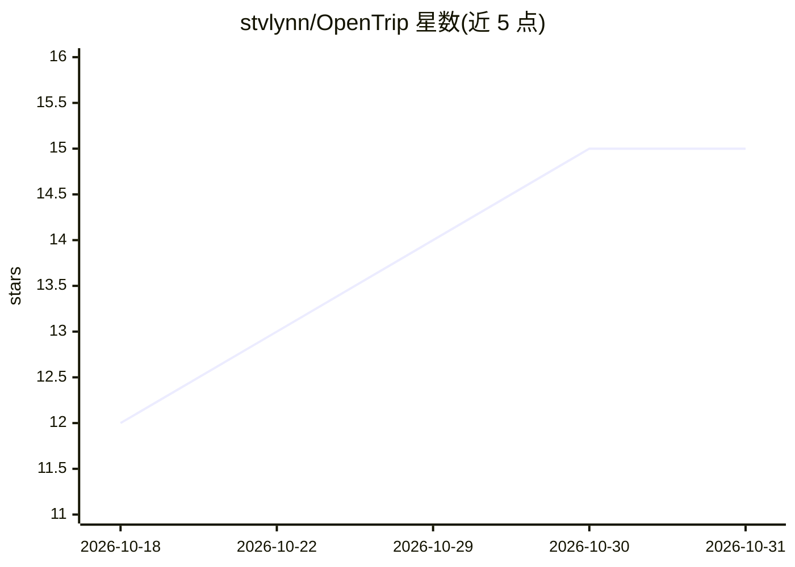

# stvlynn/OpenTrip

⭐ 15 · TypeScript · Apache-2.0 · 推送 2026-07-29 · [GitHub](https://github.com/stvlynn/OpenTrip) · [官网](https://opentrip.im) · 个人维护 · 中文 README

**小组协作旅行规划 SaaS：地图行程、投票与费用分摊**

面向小团体的协作旅行规划应用：在地图上编排带编号停靠点与分日路线，提供日程看板、共享记账（余额与最少转账结算）、多币种显示、预订追踪、邀请链接与成员角色、停靠点投票和评论。AI 部分为行程共享的 Trip agent 聊天，可给建议并在人工批准下执行带工具的修改。技术栈为 React 19 + Hono + PostgreSQL，可部署到 Cloudflare 或 Docker Compose，提供桌面端与 PWA，中英双语。

## 筛选速览

| 维度 | 判定 | 备注 |
|---|---|---|
| AI 角色 | `ai-enhanced` | 去掉 AI 部分产品仍成立 |
| 许可风险 | `permissive` | Apache-2.0 |
| 部署形态 | `self-host` | docker 或自建部署 |
| 模型依赖 | — | README 未给出锁定关系 |
| 硬件要求 | — | 无带数字的原话,不猜 |
| 安装摩擦 | `low` | 无编译、无系统依赖或容器化 |
| 成熟度 | — | 结构信号不足 |

## 能力要点

- 地图行程 + 分日路线 + 地点搜索与天气提示
- 共享记账：余额计算与最少转账结算图，多币种显示
- Trip agent：行程级 AI 聊天，工具写入需人工批准
- 停靠点投票、评论、邀请链接与成员角色协作

## 适用场景

- 和朋友一起在地图上规划并表决行程
- 旅行中记录共同开销并算清谁该给谁转多少
- 用 AI 助手问行程建议并批准其修改计划

## 场景标签

 · 领域:旅行/协作应用

## 证据(README 行号)

> L7:  Collaborative travel planning for small groups — map itineraries, day schedules,
> L61: |**Trip agent**|Shared AI chat per trip — ask about the plan, get suggestions, apply changes with approval|

## 星数曲线

2026-10-18 12 → 2026-10-31 15（+3）

---
*卡片 v1 · prompt 1.4 · 生成 2026-10-30 · 置信度 mid · 依据 README sha `fce175359d6f` · [字段定义](../../DATASET.md)*
