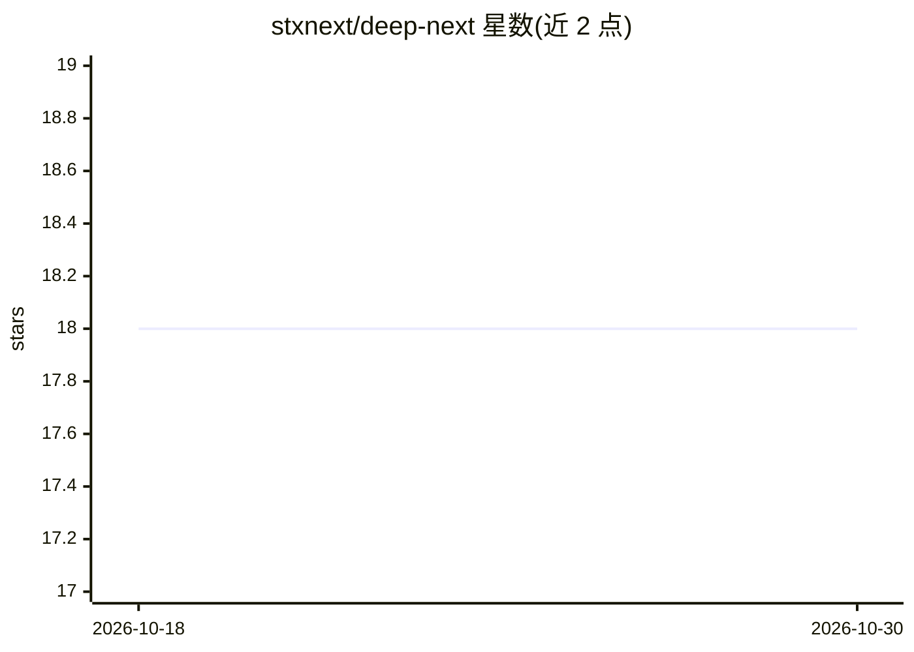

# stxnext/deep-next

⭐ 18 · Python · Apache-2.0 · 推送 2026-01-27 · [GitHub](https://github.com/stxnext/deep-next) · [官网](https://stxnext.github.io/deep-next) · 组织维护

**将 issue 描述自动转为 pull request 的 AI 编程助手**

面向开发者的 AI 编程助手：读取 issue 描述后自动分析代码仓库、生成解决方案计划并实现代码，最终产出 pull request，可作为服务接入 GitHub/GitLab 自动处理 issue。支持多种 LLM 提供商（OpenAI、AWS Bedrock、Ollama 本地模型），通过 llm-config.yaml 为流水线各阶段配置模型；集成 LangSmith 做追踪与指标，可在 LangGraph Studio 中查看工作流图。以 Python 项目形式提供，采用 Apache 2.0 许可。

## 筛选速览

| 维度 | 判定 | 备注 |
|---|---|---|
| AI 角色 | `ai-native` | 本体是模型或模型工具 |
| 许可风险 | `permissive` | Apache-2.0 |
| 部署形态 | `None` |  |
| 模型依赖 | local-ok | 支持本地模型 |
| 硬件要求 | — | 无带数字的原话,不猜 |
| 安装摩擦 | `low` | 无编译、无系统依赖或容器化 |
| 成熟度 | — | 结构信号不足 |

## 能力要点

- 从 issue 到 pull request 的端到端自动化流水线
- 支持 OpenAI、AWS Bedrock、Ollama 等多种 LLM 提供商
- 各流水线阶段可分别配置模型
- 可作为服务接入 GitHub/GitLab 自动处理 issue

## 适用场景

- 自动把 issue 转成可审查的 pull request
- 用本地 Ollama 模型处理编码任务
- 追踪 AI 编码流水线的指标与运行图

## 场景标签

`编码 Agent` · 领域:编码与开发

## 证据(README 行号)

> L3: Your AI-powered junior software engineering assistant that takes an issue description and converts it into a pull re
> L5: DeepNext is an advanced AI system that automatically analyzes a code repository, prepares a solution plan, and imple

## 星数曲线

2026-10-18 18 → 2026-10-30 18（+0）

---
*卡片 v1 · prompt 1.4 · 生成 2026-10-29 · 置信度 high · 依据 README sha `2d1d6c1b2254` · [字段定义](../../DATASET.md)*
