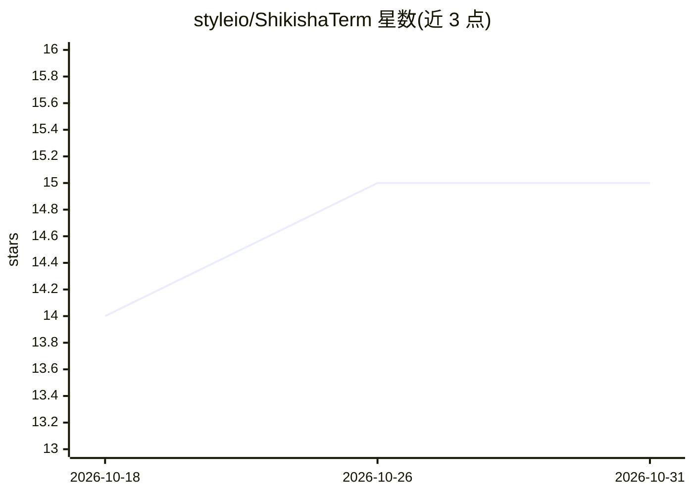

# styleio/ShikishaTerm

⭐ 15 · Rust · MIT · 推送 2026-10-30 · [GitHub](https://github.com/styleio/ShikishaTerm) · [官网](https://shikisha-term.com) · 个人维护

**Windows 便携终端：多 AI CLI 并排运行并互相转交任务**

面向使用多个终端 AI 编码代理的开发者的桌面终端：在一个窗口中以多标签/分屏同时运行 Claude Code、Codex、Gemini CLI、Aider 等，通过 @mention 让代理互发指令与回复（如写代码-评审循环，可设循环上限），从屏幕状态检测 working/finished/waiting。附带内置浏览器、Git 面板、SFTP、SSH/WSL 终端、E2B MicroVM 云端代理、手机 QR 码远程查看与下达指令、Lua 自动化与失控保护。Windows 从 Microsoft Store 或便携 zip 安装；Linux 提供 apt/rpm/静态二进制服务端。使用既有订阅的 CLI，不存储 API key。

## 筛选速览

| 维度 | 判定 | 备注 |
|---|---|---|
| AI 角色 | `ai-ecosystem` | LLM/agent 周边工具 |
| 许可风险 | `permissive` | MIT |
| 部署形态 | `desktop` | 安装包/桌面程序 |
| 模型依赖 | local-ok | 支持本地模型 |
| 硬件要求 | — | 无带数字的原话,不猜 |
| 安装摩擦 | `medium` | 含编译或系统依赖之一 |
| 成熟度 | — | 结构信号不足 |

## 能力要点

- @mention 让多个 AI CLI 代理互发任务并读回结果，支持写-评审循环与轮次上限
- 每标签从屏幕内容检测 working/done/waiting 状态，不依赖厂商 API
- E2B MicroVM 云端运行代理，git token 不进入虚拟机
- 手机扫码远程查看所有标签状态并下达指令（Tailscale/LAN）

## 适用场景

- 同时跑多个 AI 编码代理并让它们互相评审代码
- 把长任务交给云端 MicroVM 代理，路上用手机查看和续指
- 在分支 worktree 中并行推进多个任务并收到 Slack/Discord 通知

## 场景标签

`多智能体` `编码 Agent` · 领域:Agent 开发

## 证据(README 行号)

> L3:  Run many AI agents at once and let them @mention each other for help — on your PC, in the cloud, or from your phone
> L6:  Works with Claude Code · Codex · Gemini CLI · Aider · OpenAI · Anthropic · DeepSeek · Mistral · OpenRouter · Ollama
> L40: It talks to whatever runs in a terminal, so it is not tied to one vendor: Claude Code,

## 星数曲线

2026-10-18 14 → 2026-10-31 15（+1）

---
*卡片 v1 · prompt 1.4 · 生成 2026-10-30 · 置信度 high · 依据 README sha `8c532d448315` · [字段定义](../../DATASET.md)*
