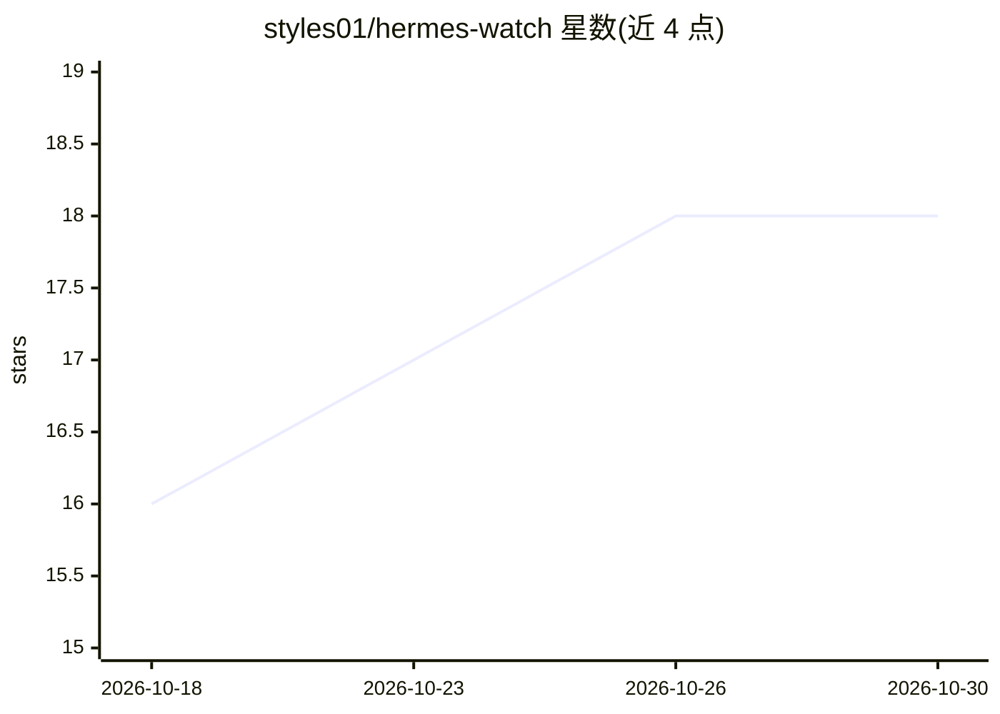

# styles01/hermes-watch

⭐ 18 · C++ · AGPL-3.0 · 推送 2026-10-10 · [GitHub](https://github.com/styles01/hermes-watch) · [官网](https://github.com/NousResearch/hermes-agent) · 个人维护

**给 AI agent 用户的语音遥控器：M5Stack 圆屏手表固件**

运行在 M5Stack StopWatch（ESP32-S3 圆形 AMOLED）上的 Hermes Agent 平台遥控器固件：按住按钮说话，16 kHz PCM 经 WebSocket 推送到 hub，STT→agent→TTS 结果在手表上播放。支持五个 agent 配置切换、程序化头像与状态环、回复卡片与批准卡片、快速命令屏，以及带 HMAC 签名与 SHA-256 校验的 WiFi OTA 自更新。仓库含固件、gateway 插件（MIT）与桌面模拟器；固件与头像引擎为 AGPL-3.0。需 arduino-cli 编译烧录或使用 Releases 预编译镜像。

## 筛选速览

| 维度 | 判定 | 备注 |
|---|---|---|
| AI 角色 | `ai-ecosystem` | LLM/agent 周边工具 |
| 许可风险 | `viral` | AGPL-3.0 |
| 部署形态 | `desktop` | 安装包/桌面程序 |
| 模型依赖 | — | README 未给出锁定关系 |
| 硬件要求 | — | 无带数字的原话,不猜 |
| 安装摩擦 | `low` | 无编译、无系统依赖或容器化 |
| 成熟度 | — | 结构信号不足 |

## 能力要点

- Push-to-talk 语音回合：PCM 经 WebSocket 推送，STT→agent→TTS 回放
- 五个 agent 配置切换，头像 HUD 与状态环显示当前回合
- 回复卡片、批准卡片（A yes/B no）、工具进度 ticker
- HMAC 签名 + SHA-256 流式校验的 WiFi OTA，带回滚机制

## 适用场景

- 在手腕上用语音驱动 Hermes agent 并听取回答
- 通过批准卡片即时应答 agent 的 yes/no 问题
- 用 STATUS/RECAP 等快速命令远程触发 agent 回合

## 场景标签

`语音 Agent` · 领域:对话与助手

## 证据(README 行号)

> L5: **A voice remote for your AI agents — on the M5Stack StopWatch round AMOLED.**
> L100: The **entire server side lives in this repo**: `gateway/` is a Hermes platform plugin —

## 星数曲线

2026-10-18 16 → 2026-10-30 18（+2）

---
*卡片 v1 · prompt 1.4 · 生成 2026-10-29 · 置信度 high · 依据 README sha `5b41f6336cfa` · [字段定义](../../DATASET.md)*
