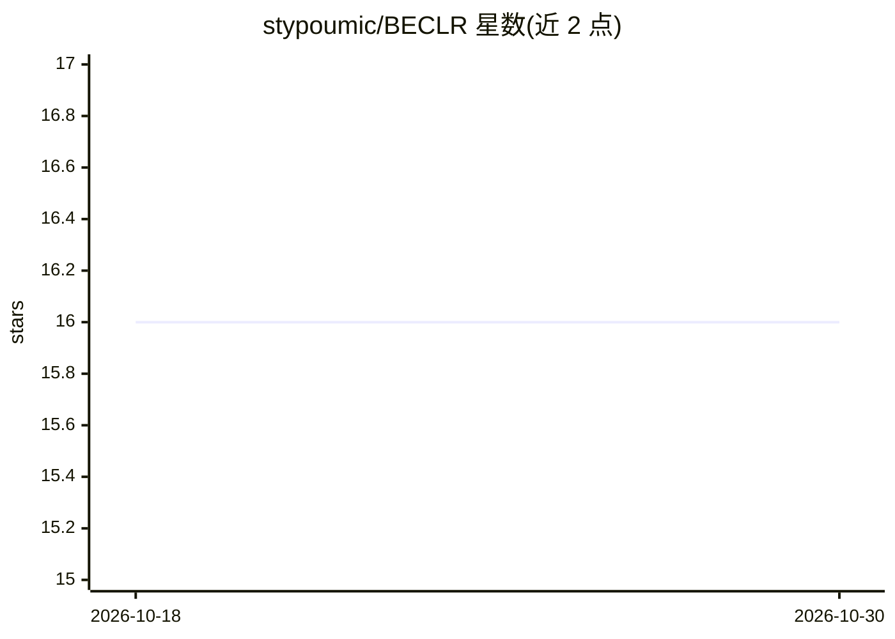

# stypoumic/BECLR

⭐ 16 · Python · Apache-2.0 · 推送 2026-05-25 · [GitHub](https://github.com/stypoumic/BECLR) · [官网](https://stypoumic.github.io/BECLR/) · 个人维护

**ICLR 2024 论文 BECLR 官方代码：无监督小样本学习训练与评测**

论文 'BECLR: Batch Enhanced Contrastive Few-Shot Learning'（ICLR 2024 Spotlight）的官方 PyTorch 实现。提出 DyCE 动态聚类记忆模块用于预训练阶段的正样本采样，以及 OpTA 基于最优传输的分布对齐模块用于小样本推理阶段的样本偏置处理。提供 miniImageNet、tieredImageNet、CIFAR-FS、FC100、CDFSL、CUB 等基准的数据准备脚本与训练/评测脚本，通过 conda 环境与 torch.distributed.launch 运行。面向复现实验或在此基础上做研究的科研人员。

## 筛选速览

| 维度 | 判定 | 备注 |
|---|---|---|
| AI 角色 | `ai-native` | 本体是模型或模型工具 |
| 许可风险 | `permissive` | Apache-2.0 |
| 部署形态 | `None` |  |
| 模型依赖 | — | README 未给出锁定关系 |
| 硬件要求 | — | 无带数字的原话,不猜 |
| 安装摩擦 | `low` | 无编译、无系统依赖或容器化 |
| 成熟度 | — | 结构信号不足 |

## 能力要点

- DyCE 动态聚类记忆模块用于无监督对比预训练
- OpTA 基于最优传输的分布对齐，无额外可学习参数
- 支持 RN18/RN50 骨干网络，覆盖 miniImageNet/tieredImageNet 等基准
- 提供分布式训练与评测脚本及 JSON 配置文件

## 适用场景

- 复现论文在 U-FSL 基准上的实验结果
- 在 BECLR 基础上开展无监督小样本学习研究
- 使用其数据准备脚本构建小样本学习基准数据集

## 场景标签

`模型训练` `模型评测` · 领域:评测与运维

## 证据(README 行号)

> L2: ### Official Implementation for "BECLR: Batch Enhanced Contrastive Few-Shot Learning" (Stylianos Poulakakis-Daktylid
> L134: First create an anaconda environment with all the required libraries, packages and dependencies: `conda env create

## 星数曲线

2026-10-18 16 → 2026-10-30 16（+0）

---
*卡片 v1 · prompt 1.4 · 生成 2026-10-30 · 置信度 high · 依据 README sha `aa45b82aa193` · [字段定义](../../DATASET.md)*
