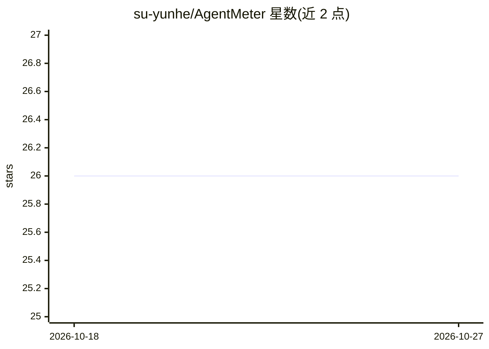

# su-yunhe/AgentMeter

⭐ 26 · Rust · 推送 2026-06-26 · [GitHub](https://github.com/su-yunhe/AgentMeter) · 个人维护 · 中文 README

**本地桌面工具：汇总 AI Coding 工具的 Token 与成本使用数据**

面向开发者的本地桌面应用，基于 Tauri 2 + React + TypeScript + SQLite 构建，用于汇总和展示电脑上 AI Coding 工具（Codex、Claude Code、Cursor 等）的使用情况。功能包括实时总览（请求数、会话数、Token、估算成本）、Token 趋势监控、工具与模型分布对比、按代码仓库的项目维度分析和过去 30 天的月度报告与导出（Markdown/CSV/HTML）。项目处于第一阶段，目前具备桌面工程骨架、SQLite 初始化和报表查询接口占位，各数据源采集器为计划接入。

## 筛选速览

| 维度 | 判定 | 备注 |
|---|---|---|
| AI 角色 | `ai-ecosystem` | LLM/agent 周边工具 |
| 许可风险 | `none` | — |
| 部署形态 | `library` | 以包/库形式分发 |
| 模型依赖 | — | README 未给出锁定关系 |
| 硬件要求 | — | 无带数字的原话,不猜 |
| 安装摩擦 | `low` | 无编译、无系统依赖或容器化 |
| 成熟度 | `idea` | |

## 能力要点

- 区分输入、输出、reasoning、缓存等 Token 维度并估算成本
- 按代码仓库维度映射 Token 与成本投入
- 过去 30 天月度报告与 Markdown/CSV/HTML 导出
- 本地优先（local-first），Tauri 2 + Rust + SQLite 存储

## 适用场景

- 查看今天和过去一个月各 AI Coding 工具的 Token 与花费
- 把 AI 使用成本映射回具体代码项目
- 按工具、模型、项目做月度复盘并导出报告

## 场景标签

`LLM 可观测性` · 领域:评测与运维

## 证据(README 行号)

> L11: AgentMeter 是一个面向开发者的本地桌面工具，用于汇总和展示电脑上 AI Coding 工具的使用情况。它关注的不只是“用了多少”，还包括：
> L68: 当前项目还处于第一阶段，重点是把本地采集、统一存储和报表查询链路搭起来，为后续接入更多 AI Coding 数据源做准备。

## 星数曲线

2026-10-18 26 → 2026-10-27 26（+0）

---
*卡片 v1 · prompt 1.4 · 生成 2026-10-26 · 置信度 high · 依据 README sha `d945dd7f2f61` · [字段定义](../../DATASET.md)*
