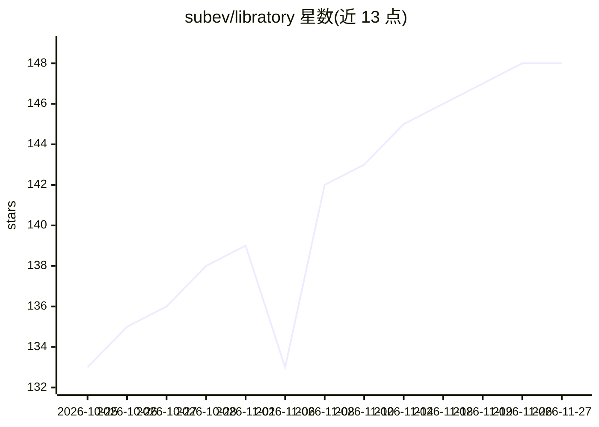

# subev/libratory

⭐ 148 · TypeScript · NOASSERTION · 推送 2026-11-06 · [GitHub](https://github.com/subev/libratory) · [官网](https://libratory.dev) · 个人维护

**把自有 PDF 制作为带章节标记的有声书与双语书的本机工作台**

在本地运行的图书处理工作台：将用户自有 PDF 解析、OCR 清理、检测章节，合成为带章节标记的 M4B 有声书、句子级高亮的跟读书和逐句对照的双语版本。TTS 引擎本地运行，翻译/改写/清理/问答可对接 Ollama 或 LM Studio（自动发现），云端 API 为可选。提供旁板助手，基于 BGE-M3 的全文+语义混合检索带引用回答，并可经 MCP 服务器或 JSON API 由外部 agent 驱动。许可证为 PolyForm Noncommercial 1.0.0，仅限非商业用途。

## 筛选速览

| 维度 | 判定 | 备注 |
|---|---|---|
| AI 角色 | `ai-native` | 本体是模型或模型工具 |
| 许可风险 | `none` | NOASSERTION |
| 部署形态 | `self-host` | docker 或自建部署 |
| 模型依赖 | local-ok | 支持本地模型 |
| 硬件要求 | `cpu-ok` | |
| 安装摩擦 | `low` | 无编译、无系统依赖或容器化 |
| 成熟度 | — | 结构信号不足 |

## 能力要点

- PDF → 带章节标记的 M4B 有声书，支持逐章编辑与重合成
- 本地 TTS 与离线优先：翻译/清理/问答可走 Ollama 或 LM Studio，无 key 时不外发数据
- 带可点击引用的图书内容混合检索助手（BGE-M3 嵌入）
- MCP 服务器与 JSON API，agent 可端到端把 PDF 路径变成有声书

## 适用场景

- 把自己拥有的 PDF 书制作成可在播放器显示章节的有声书
- 制作句子对照、可交替朗读的双语版本辅助阅读
- 对本机书库做带出处的问答并保存为笔记或章节
- 通过 Claude Code/Cursor 等 agent 一条命令把 PDF 转成有声书

## 场景标签

`语音合成` `RAG` `OCR` `文档解析` · 领域:内容生成

## 证据(README 行号)

> L4:  Turn the PDFs you already own into chapter-marked audiobooks — on your own machine, offline-first.
> L15: Take a book apart, clean up the OCR, translate or rewrite a chapter, pick a voice, and put it back together as an M
> L19: **Offline-first, not offline-only.** Every narrator and every AI feature has a local option — the TTS engines run o

## 星数曲线

2026-10-25 133 → 2026-11-27 148（+15）

---
*卡片 v1 · prompt 1.4 · 生成 2026-11-27 · 置信度 high · 依据 README sha `1dcc8b1cb137` · [字段定义](../../DATASET.md)*
