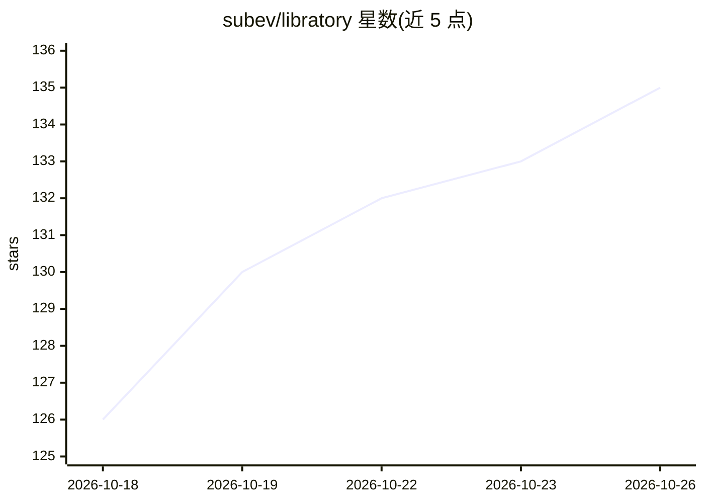

# subev/libratory

⭐ 135 · TypeScript · NOASSERTION · 推送 2026-10-24 · [GitHub](https://github.com/subev/libratory) · [官网](https://libratory.dev) · 个人维护

**本地自托管的电子书/有声书工坊：PDF 转 M4B 有声书、双语版与跟读**

面向个人读者的本地优先图书工具：把自有 PDF 转成带章节标记的 M4B 有声书、可在原页面上逐句高亮的跟读书籍，或逐句对照的双语版本，并可导出 EPUB/同步 EPUB。TTS 与翻译、改写、清理、摘要、问答等 AI 功能均支持本地引擎（Ollama/LM Studio 自动发现、本地 TTS），云端（DeepSeek/OpenAI/Anthropic/Gemini 等）为可选。内置基于 BGE-M3 混合检索、带可点击引用的跨语言助手，另提供 JSON API 与 MCP 服务器供脚本或 agent 调用。运行于 Apple Silicon Mac、Linux 或单个 Docker 容器；许可为 PolyForm Noncommercial 1.0.0（禁止商用）。

## 筛选速览

| 维度 | 判定 | 备注 |
|---|---|---|
| AI 角色 | `ai-native` | 本体是模型或模型工具 |
| 许可风险 | `none` | NOASSERTION |
| 部署形态 | `self-host` | docker 或自建部署 |
| 模型依赖 | local-ok | 支持本地模型 |
| 硬件要求 | — | 无带数字的原话,不猜 |
| 安装摩擦 | `low` | 无编译、无系统依赖或容器化 |
| 成熟度 | — | 结构信号不足 |

## 能力要点

- PDF→章节标记 M4B 有声书、跟读高亮与双语对照三种产出
- AI 功能均有本地选项：Ollama/LM Studio 自动发现、本地 TTS，云端严格可选
- 跨语言混合检索助手，答案流式输出且带可点击引用
- JSON API 与 MCP 服务器，可由脚本或 AI agent 全流程驱动图书馆

## 适用场景

- 把我拥有的 PDF 做成带章节的有声书自己听
- 边听旁白边在原书页面上跟读，或逐句对照读双语版
- 离线环境下对藏书提问并获得带出处的回答
- 通过 MCP 让 agent 自动完成上传、翻译、合成、导出

## 场景标签

`语音合成` `RAG` · 领域:内容生成

## 证据(README 行号)

> L19: **Offline-first, not offline-only.** Every narrator and every AI feature has a local option — the TTS engines run o
> L23: - **PDF → audiobook** — it finds the chapters, narrates each one, and gives you a single M4B with chapter markers a

## 星数曲线

2026-10-18 126 → 2026-10-26 135（+9）

---
*卡片 v1 · prompt 1.4 · 生成 2026-10-22 · 置信度 high · 依据 README sha `f799e4bd529f` · [字段定义](../../DATASET.md)*
