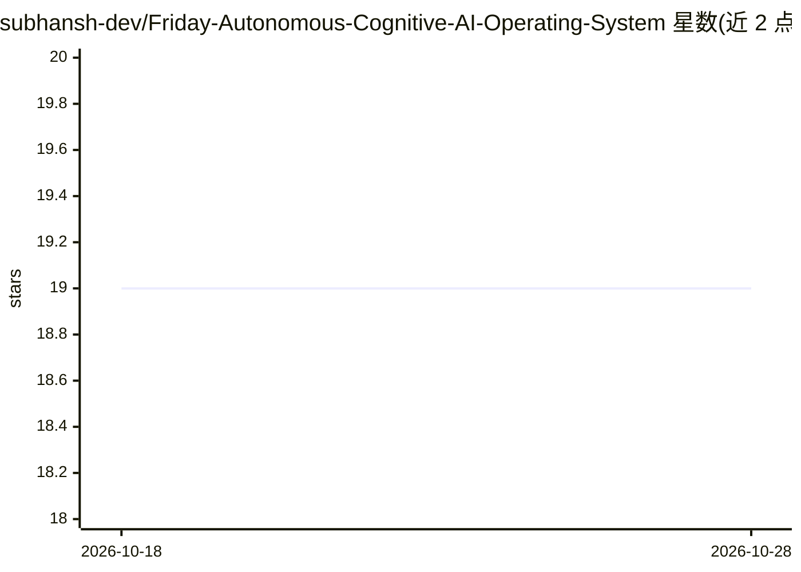

# subhansh-dev/Friday-Autonomous-Cognitive-AI-Operating-System

⭐ 19 · Python · NOASSERTION · 推送 2026-07-17 · [GitHub](https://github.com/subhansh-dev/Friday-Autonomous-Cognitive-AI-Operating-System) · 个人维护

**本地运行的自主体 AI 操作系统，集成记忆、语音、研究与安全分析**

纯 Python 实现的认知架构助手：62 个认知模块经全局工作区协调，包含 9 类记忆系统、实时 Gemini Live 语音对话、自主研究/创意写作引擎、文档智能、30 个专家 agent 的多 agent 编排、系统控制与浏览器自动化，以及可选的网络安全分析模块（含目标授权守卫与审计日志）。支持自我改进（代码演化）。要求 4GB 内存、无 GPU、Python 3.12，作者声明项目仍处实验阶段。

## 筛选速览

| 维度 | 判定 | 备注 |
|---|---|---|
| AI 角色 | `ai-native` | 本体是模型或模型工具 |
| 许可风险 | `none` | NOASSERTION |
| 部署形态 | `library` | 以包/库形式分发 |
| 模型依赖 | — | README 未给出锁定关系 |
| 硬件要求 | `cpu-ok` | |
| 安装摩擦 | `low` | 无编译、无系统依赖或容器化 |
| 成熟度 | `idea` | |

## 能力要点

- 62 个认知模块与 9 类记忆系统（神经/情景/向量/程序性等）
- 实时 Gemini Live 语音对话，10 种语音情绪
- 30 个专家 agent 支持并行/辩论/流水线/集群模式
- 可选安全模块内置目标分类守卫与授权审计日志

## 适用场景

- 本地运行一个带持久记忆的个人 AI 助手
- 语音交互执行研究、写作、文档分析与编码任务
- 在授权范围内进行安全扫描与漏洞分析
- 控制鼠标键盘与浏览器完成系统自动化操作

## 场景标签

`多智能体` `浏览器自动化` `AI 助手` `GUI 自动化` · 领域:Agent 开发

## 证据(README 行号)

> L3: # 🌌 F.R.I.D.A.Y. — Autonomous Cognitive AI Operating System for General Intelligence
> L72: **F.R.I.D.A.Y.** is a next-generation **Autonomous Cognitive AI Operating System** — not a chatbot, not a wrapper a
> L150: |🎙️ **Voice**|Real-time Gemini Live API conversation, 10 voice emotions, 5 voice types|

## 星数曲线

2026-10-18 19 → 2026-10-28 19（+0）

---
*卡片 v1 · prompt 1.4 · 生成 2026-10-28 · 置信度 high · 依据 README sha `0246548d90d9` · [字段定义](../../DATASET.md)*
