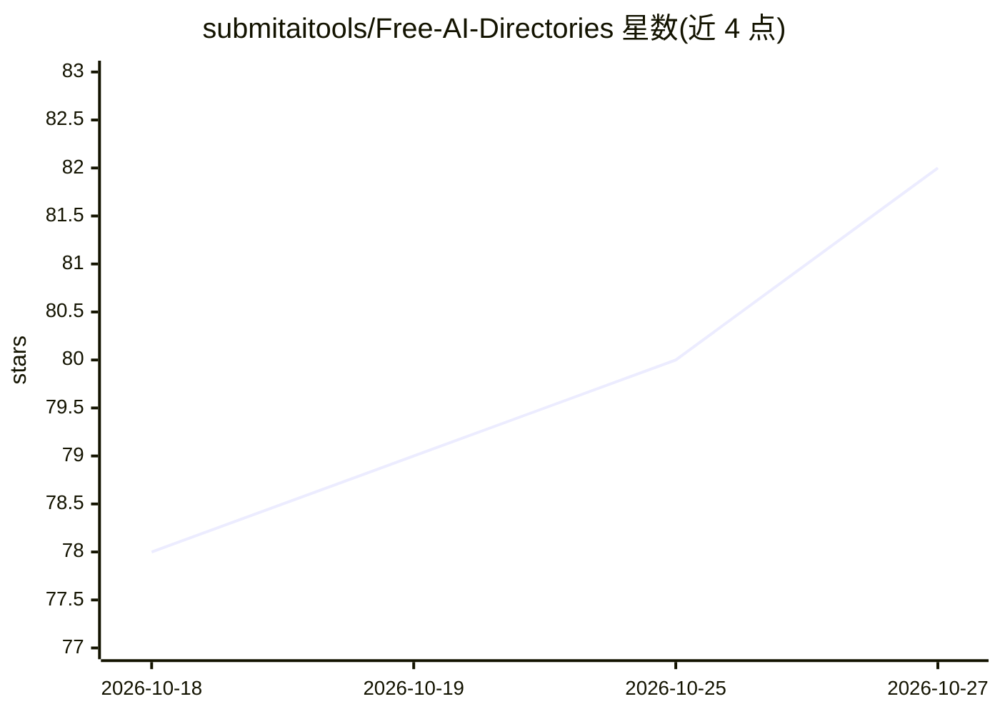

# submitaitools/Free-AI-Directories

⭐ 82 · MIT · 推送 2026-10-11 · [GitHub](https://github.com/submitaitools/Free-AI-Directories) · [官网](https://submitaitools.org) · 组织维护

**免费 AI 工具目录站清单：附 DA 分数与提交链接**

面向 AI 开发者、创业团队与产品团队的 AI 工具目录站策展清单：收录约 180 个可免费提交 AI 产品的目录平台，每条包含名称、链接、提交入口、Domain Rating 域名评分与月访问量估计，用于发现、对比和选择提交渠道以提升产品曝光。维护方为 Submit AI Tools（同时在列表首位）。新增目录通过邮件提交名称、URL、标语与 DA 信息。

## 筛选速览

| 维度 | 判定 | 备注 |
|---|---|---|
| AI 角色 | `ai-knowledge` | 知识聚合/清单类 |
| 许可风险 | `permissive` | MIT |
| 部署形态 | `None` |  |
| 模型依赖 | — | README 未给出锁定关系 |
| 硬件要求 | — | 无带数字的原话,不猜 |
| 安装摩擦 | `low` | 无编译、无系统依赖或容器化 |
| 成熟度 | — | 结构信号不足 |

## 能力要点

- 约 180 个 AI 工具目录条目，含提交链接
- 每条附 Domain Rating 与月访问量数据
- 通过邮件流程接收新目录条目

## 适用场景

- 为我的 AI 产品挑选合适的免费提交渠道
- 按 DA 与流量对比各目录平台的曝光潜力
- 查找 AI 工具发现与推广平台清单

## 场景标签

`精选清单` · 领域:学习与行业

## 证据(README 行号)

> L3: **Welcome to “AI Directories Collection,”**
> L8: We’ve gathered and organized directories from across the web, complete with **Domain Authority scores, direct links,

## 星数曲线

2026-10-18 78 → 2026-10-27 82（+4）

---
*卡片 v1 · prompt 1.4 · 生成 2026-10-24 · 置信度 high · 依据 README sha `7abf45359c6a` · [字段定义](../../DATASET.md)*
