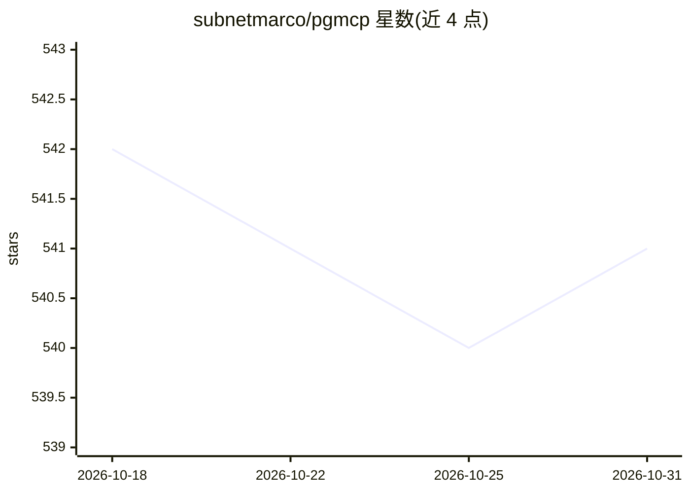

# subnetmarco/pgmcp

⭐ 541 · Go · NOASSERTION · 推送 2026-05-26 · [GitHub](https://github.com/subnetmarco/pgmcp) · 个人维护

**用自然语言查询任意 PostgreSQL 数据库的 MCP 服务器**

用 Go 编写的 MCP（Model Context Protocol）服务器，把用户已有的 PostgreSQL 数据库接入 AI 助手（Cursor、Claude Desktop、VS Code 扩展等 MCP 客户端）：自然语言经 OpenAI 模型转为 SQL，结果以表/JSON/CSV 输出并自动流式处理。安全机制包括只读强制、查询超时、输入校验与只读事务。提供预编译二进制、Docker 镜像与源码构建三种分发方式，附带客户端 CLI 与示例数据库 schema。OpenAI API key 为可选项。

## 筛选速览

| 维度 | 判定 | 备注 |
|---|---|---|
| AI 角色 | `ai-ecosystem` | LLM/agent 周边工具 |
| 许可风险 | `none` | NOASSERTION |
| 部署形态 | `self-host` | docker 或自建部署 |
| 模型依赖 | — | README 未给出锁定关系 |
| 硬件要求 | — | 无带数字的原话,不猜 |
| 安装摩擦 | `low` | 无编译、无系统依赖或容器化 |
| 成熟度 | — | 结构信号不足 |

## 能力要点

- 自然语言转 SQL，结果自动流式输出
- 只读访问强制、查询超时、只读事务等安全机制
- 兼容 Cursor / Claude Desktop 等 MCP 客户端
- 提供预编译二进制、Docker/Kubernetes 部署与 CLI 客户端

## 适用场景

- 在 Cursor 或 Claude Desktop 中直接用自然语言查询业务数据库
- 让 AI 助手对已有 PostgreSQL 库做数据检索与文本搜索
- 以只读安全方式向 AI 客户端开放数据库访问

## 场景标签

`数据分析` · 领域:效率与自动化

## 证据(README 行号)

> L5: # PGMCP - PostgreSQL Model Context Protocol Server
> L7: PGMCP connects AI assistants to **any PostgreSQL database** through natural language queries. Ask questions in plain
> L9: **Works with**: Cursor, Claude Desktop, VS Code extensions, and any MCP-compatible client

## 星数曲线

2026-10-18 542 → 2026-10-31 541（-1）

---
*卡片 v1 · prompt 1.4 · 生成 2026-10-21 · 置信度 high · 依据 README sha `7621a3cdd886` · [字段定义](../../DATASET.md)*
