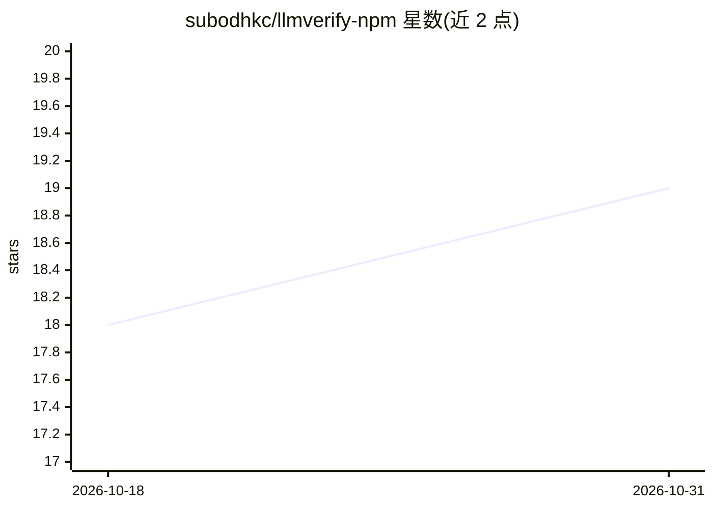

# subodhkc/llmverify-npm

⭐ 19 · TypeScript · NOASSERTION · 推送 2026-10-09 · [GitHub](https://github.com/subodhkc/llmverify-npm) · [官网](https://www.npmjs.com/package/llmverify) · 个人维护

**LLM 应用运行时安全校验库：幻觉风险/PII/注入/漂移检测**

嵌入在 LLM 与用户之间的 npm 校验层：对模型输出运行确定性、基于模式的本地引擎，产出幻觉信号、一致性、安全检查与风险等级；拦截提示注入与越狱输入，正则掩码 PII（邮件/电话/SSN/信用卡/API key），检测并修复损坏 JSON，包装客户端追踪延迟与 token 漂移，并写入本地哈希审计日志。附带 CLI、绑定 127.0.0.1 的服务模式及 stdio-only 的 MCP server（6 个工具）。免费层完全本地、零网络请求，每日限 500 次校验；ML 增强功能需付费层与 API key。PII 检测为正则式，标准格式准确率约 90%。

## 筛选速览

| 维度 | 判定 | 备注 |
|---|---|---|
| AI 角色 | `ai-ecosystem` | LLM/agent 周边工具 |
| 许可风险 | `permissive` | NOASSERTION |
| 部署形态 | `library` | 以包/库形式分发 |
| 模型依赖 | — | README 未给出锁定关系 |
| 硬件要求 | — | 无带数字的原话,不猜 |
| 安装摩擦 | `low` | 无编译、无系统依赖或容器化 |
| 成熟度 | — | 结构信号不足 |

## 能力要点

- 确定性模式引擎，本地运行，免费层零网络请求
- verify/redactPII/isInputSafe/monitorLLM 等校验 API
- 内置 MCP server（6 个工具，stdio，零外发网络）
- 本地哈希审计日志，基线映射 OWASP LLM Top 10 / NIST AI RMF / EU AI Act / ISO 42001

## 适用场景

- 在模型输出到达用户前拦截提示注入与 PII 泄露
- 对 LLM 应用做运行时质量监控与漂移追踪
- CI/回归流程中用 prodVerify/ciVerify 预设管线校验输出
- 让 MCP 兼容的 agent/IDE 直接调用校验工具

## 场景标签

`网络安全` `LLM 可观测性` · 领域:评测与运维

## 证据(README 行号)

> L5: Local-first verification, PII redaction, prompt-injection defense, and runtime monitoring for any LLM. One `npm inst
> L53: |`monitorLLM(client)`|`monitorLLM(openaiClient)`|Wraps any LLM client; tracks latency, token drift, and behavioral 
> L72: llmverify runs deterministic, pattern-based engines locally — no model calls, no network on the free tier. Same inp

## 星数曲线

2026-10-18 18 → 2026-10-31 19（+1）

---
*卡片 v1 · prompt 1.4 · 生成 2026-10-29 · 置信度 mid · 依据 README sha `433bec58e601` · [字段定义](../../DATASET.md)*
