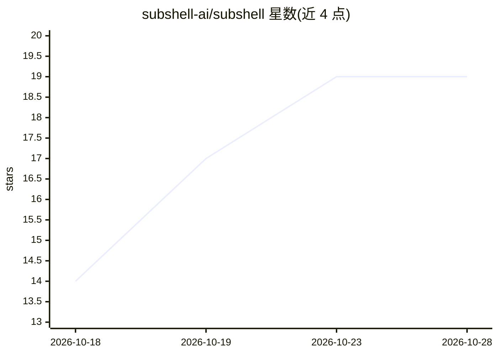

# subshell-ai/subshell

⭐ 19 · TypeScript · NOASSERTION · 推送 2026-10-28 · [GitHub](https://github.com/subshell-ai/subshell) · [官网](https://subshell.sh) · 组织维护

**自托管仪表盘：跨设备访问并管理编码 agent CLI**

开源、可自托管的交互式编码 agent 仪表盘：在本机或注册节点上运行 Claude Code、Codex 等 agent CLI，通过浏览器或桌面客户端访问。内置插件支持 Claude Code、Codex、OpenCode、Hermes、pi 与普通终端，可经插件 API 扩展；提供工作区会话管理、共享视图/编辑权限、会话不停机拖拽迁移，以及支持跨 agent 通信与加密通道的内置 MCP 服务器。安装途径含桌面安装包、CLI、Docker 与 Proxmox LXC。

## 筛选速览

| 维度 | 判定 | 备注 |
|---|---|---|
| AI 角色 | `ai-ecosystem` | LLM/agent 周边工具 |
| 许可风险 | `none` | NOASSERTION |
| 部署形态 | `None` |  |
| 模型依赖 | — | README 未给出锁定关系 |
| 硬件要求 | — | 无带数字的原话,不猜 |
| 安装摩擦 | `low` | 无编译、无系统依赖或容器化 |
| 成熟度 | — | 结构信号不足 |

## 能力要点

- 内置插件支持 Claude Code、Codex、OpenCode、Hermes、pi 与普通终端
- 会话可在工作区拖拽迁移且不停止，支持跨浏览器/桌面客户端重连
- 内置 MCP 服务器支持跨 agent 通信与加密通道
- 自托管服务器与多节点注册，无需托管账户

## 适用场景

- 在自己机器上运行编码 agent 并从任意设备访问
- 与团队成员共享会话的查看或编辑权限
- 多机节点上集中运行和管理多个 agent CLI

## 场景标签

 · 领域:开发工具/agent 基础设施

## 证据(README 行号)

> L5: Subshell is an open-source, self-hosted dashboard for interactive coding agents.
> L6: Run Claude Code, Codex, and other agent CLIs on your own machines, then access
> L15: - **Your choice of agents.** Built-in plugins support Claude Code, Codex,

## 星数曲线

2026-10-18 14 → 2026-10-28 19（+5）

---
*卡片 v1 · prompt 1.4 · 生成 2026-10-28 · 置信度 high · 依据 README sha `075dde2fb57b` · [字段定义](../../DATASET.md)*
