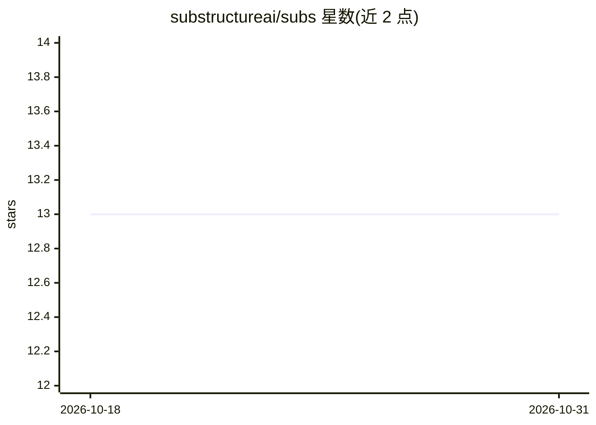

# substructureai/subs

⭐ 13 · Rust · MIT · 推送 2026-10-30 · [GitHub](https://github.com/substructureai/subs) · [官网](https://substructure.ai) · 组织维护

**云端 agent 运行框架：以 MCP 工具执行运行不可特权 agent 循环**

用 Rust 编写的 agent harness/引擎，运行无系统权限的 agent 循环，通过 MCP 服务器执行工具。用户在 subs.toml 中声明 agent，引擎负责 LLM 调用（Anthropic/OpenAI/OpenRouter）、会话状态、分支、重试、超时、崩溃恢复、子 agent 与人工审批。可本地 CLI 运行、自托管服务器或使用 substructure.ai 托管版；支持 Slack 接入与 AG-UI 客户端。自定义循环通过 HTTP webhook（worker）实现，无需 SDK。自述 Pre-1.0，API 可能变更。

## 筛选速览

| 维度 | 判定 | 备注 |
|---|---|---|
| AI 角色 | `ai-ecosystem` | LLM/agent 周边工具 |
| 许可风险 | `permissive` | MIT |
| 部署形态 | `None` |  |
| 模型依赖 | locked-api |  |
| 硬件要求 | — | 无带数字的原话,不猜 |
| 安装摩擦 | `low` | 无编译、无系统依赖或容器化 |
| 成熟度 | `idea` | |

## 能力要点

- 通过 MCP 服务器执行工具，引擎管理授权与连接
- 自定义 agent 循环：指向任意 HTTP 端点应答 webhook，无 SDK
- 每步先保存再运行，支持崩溃恢复、重试、超时与人工审批
- Anthropic/OpenAI/OpenRouter 多 LLM 支持，可自托管或用托管引擎

## 适用场景

- 在本地或自有服务器上运行带工具调用的 AI agent
- 把 agent 接入 Slack 处理私信与频道提及
- 通过 webhook 用任意语言定制 agent 循环逻辑

## 场景标签

`Agent 框架` · 领域:Agent 开发

## 证据(README 行号)

> L8: It runs an unprivileged agent loop with no system access. It uses MCP servers
> L334: - **Engine.** Runs the agent loop, in Rust. It calls the model, runs tools,

## 星数曲线

2026-10-18 13 → 2026-10-31 13（+0）

---
*卡片 v1 · prompt 1.4 · 生成 2026-10-31 · 置信度 high · 依据 README sha `217d4f115f75` · [字段定义](../../DATASET.md)*
