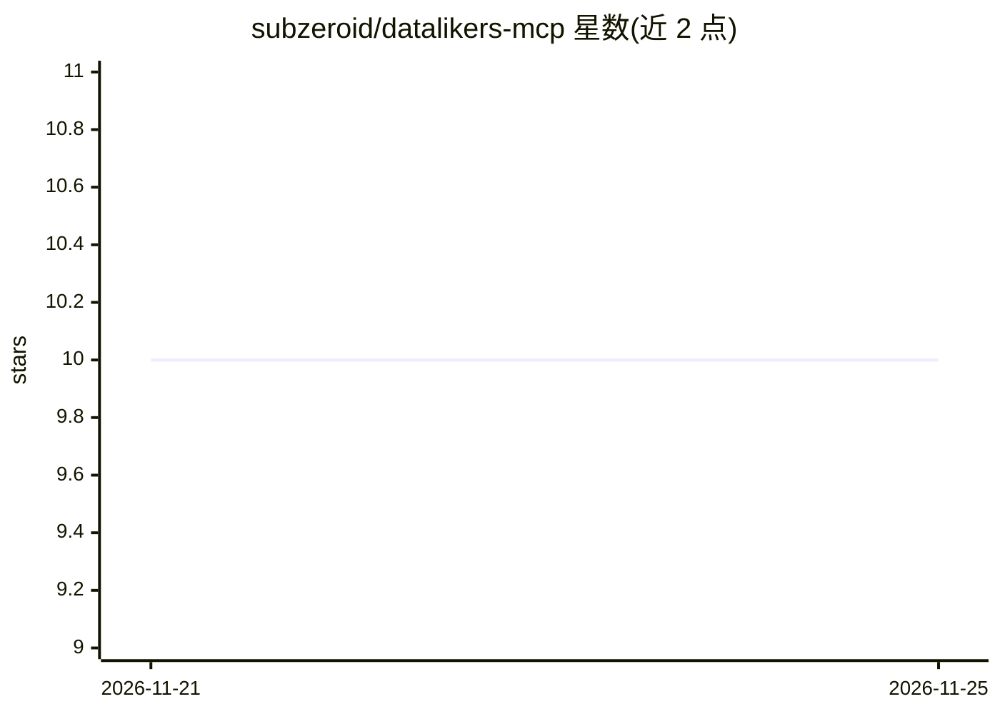

# subzeroid/datalikers-mcp

⭐ 10 · TypeScript · MIT · 推送 2026-10-06 · [GitHub](https://github.com/subzeroid/datalikers-mcp) · [官网](https://datalikers.com/p/1by27bwg) · 个人维护

**给 AI 助手接入 DataLikers 社媒数据 API 的 MCP 代理**

将 DataLikers 的 Instagram 与 TikTok 数据接口封装为 MCP server 的薄代理（stdio），共 29 个工具，覆盖用户检索、媒体与帖子、评论、话题标签、地点、Stories/Highlights、音乐与统计。本地不做数据处理，全部请求转发到 DataLikers 远程 API，需要 API key，按请求计费（注册送 100 次免费额度）。通过 claude mcp add 或各客户端 JSON 配置接入。

## 筛选速览

| 维度 | 判定 | 备注 |
|---|---|---|
| AI 角色 | `ai-ecosystem` | LLM/agent 周边工具 |
| 许可风险 | `permissive` | MIT |
| 部署形态 | `library` | 以包/库形式分发 |
| 模型依赖 | — | README 未给出锁定关系 |
| 硬件要求 | — | 无带数字的原话,不猜 |
| 安装摩擦 | `low` | 无编译、无系统依赖或容器化 |
| 成熟度 | — | 结构信号不足 |

## 能力要点

- 29 个工具覆盖 Instagram/TikTok 用户、帖子、评论、标签、地点、Stories、音乐等数据
- 薄 stdio 代理：本地不处理数据，请求转发到 DataLikers 远程 MCP/API
- 提供 Claude Code、Claude Desktop、Cursor、Windsurf 等客户端配置方式
- 支持通过环境变量自托管自定义服务端地址

## 适用场景

- 在 Claude/Cursor 中用自然语言查询 Instagram 用户画像与互动数据
- 按人口学属性（年龄、地区等）检索创作者做红人营销筛选
- 分析话题标签热度与热门帖子/音乐趋势

## 场景标签

`AI 助手` · 领域:对话与助手

## 证据(README 行号)

> L7: MCP server for DataLikers — access Instagram & TikTok data directly from Claude, Cursor, and other AI assistants. Av
> L156: This is a thin proxy that connects to the DataLikers remote MCP server and exposes all its tools locally via stdio
> L159: AI Assistant ←stdio→ datalikers-mcp ←https→ DataLikers API

## 星数曲线

2026-11-21 10 → 2026-11-25 10（+0）

---
*卡片 v1 · prompt 1.4 · 生成 2026-11-21 · 置信度 high · 依据 README sha `ade578bf4e06` · [字段定义](../../DATASET.md)*
