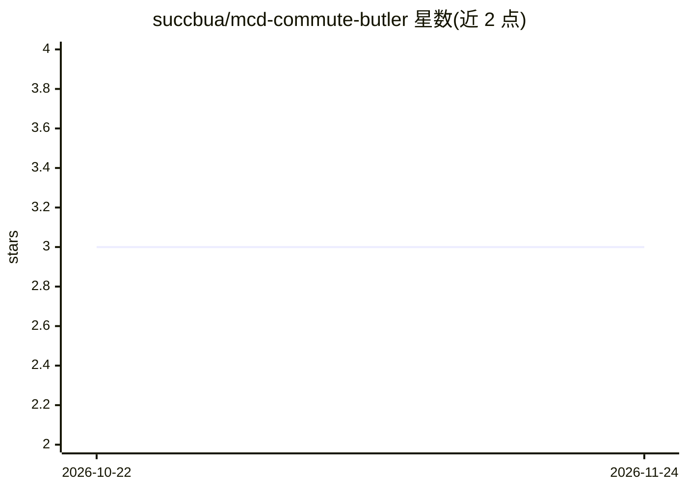

# succbua/mcd-commute-butler

⭐ — · [GitHub]() · 个人维护 · 中文 README

**给通勤上班族的麦当劳点单方案生成器：对齐供餐时段与券到期**

基于麦当劳 MCP Server 构建的 WorkBuddy Skill，按用户给出的出发时间、通勤时长、预算与口味，调用 MCP 拉取门店、菜单与优惠券，依据到达时段过滤不可售餐品，把券到期紧迫度作为独立评分轴（权重 0.25）做四维评分，输出最多三个候选方案，确认后才创建订单并返回支付链接。决策层为零依赖纯函数模块，可离线跑 --demo 与 82 个单元测试；副作用层强制人工确认，不自动付款。

## 筛选速览

| 维度 | 判定 | 备注 |
|---|---|---|
| AI 角色 | `ai-native` | 本体是模型或模型工具 |
| 许可风险 | `permissive` | — |
| 部署形态 | `None` |  |
| 模型依赖 | — | README 未给出锁定关系 |
| 硬件要求 | — | 无带数字的原话,不猜 |
| 安装摩擦 | `low` | 无编译、无系统依赖或容器化 |
| 成熟度 | — | 结构信号不足 |

## 能力要点

- 按到达时刻过滤门店不可售餐品，落到时段空档时提示下一时段开始时间
- 券到期紧迫度单列评分轴（权重 0.25），按紧迫度调度快过期券
- 渠道决策按配送费摊薄与时段余量判定自取或外送
- 决策层零依赖纯函数，无 Token 可离线跑 --demo 与单元测试

## 适用场景

- 早高峰路上让 AI 根据到达时间直接给出可下单的早餐方案
- 把手里的多张临期麦当劳券按到期紧迫度排进方案用掉
- 下雨或赶时间时让工具重算外送渠道的配送费与可用券

## 场景标签

 · 领域:本地生活/AI Agent 应用

## 证据(README 行号)

> L9: 基于 麦当劳 MCP Server 构建的 WorkBuddy Skill。
> L135: Skill 会自动调用 MCP 拉取门店、菜单与优惠券，输出候选方案，确认后才下单。
> L78: |**决策层**|时段判定、券择优、四维评分、渠道取舍|`scripts/*.mjs`（零依赖纯函数）|**否**|

## 星数曲线

2026-10-22 3 → 2026-11-24 3（+0）

---
*卡片 v1 · prompt 1.4 · 生成 2026-11-22 · 置信度 high · 依据 README sha `315b985bb3e3` · [字段定义](../../DATASET.md)*
