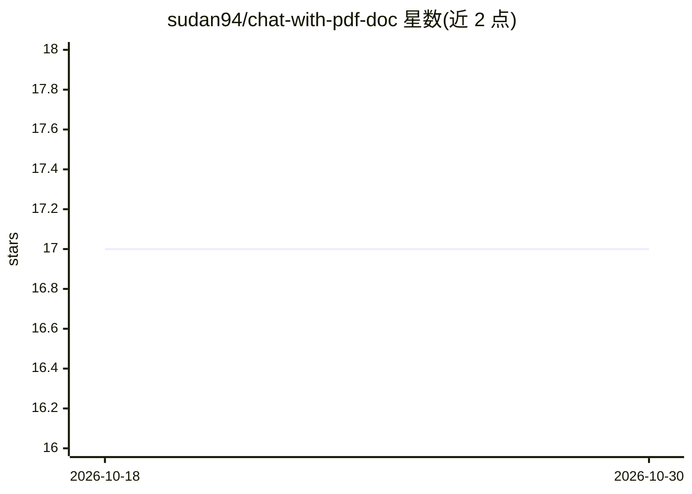

# sudan94/chat-with-pdf-doc

⭐ 17 · Python · 推送 2026-08-13 · [GitHub](https://github.com/sudan94/chat-with-pdf-doc) · 个人维护

**基于 LangGraph+OpenAI 的 PDF/DOC 文档问答聊天应用**

面向终端用户的 Streamlit 聊天应用：上传或指定 PDF、DOC 文件后以对话方式提问并抽取信息。RAG 流程以 LangGraph 状态图实现（retrieve→generate），FAISS 向量库配合 HuggingFace 嵌入做相似度检索，生成调用 ChatOpenAI，MemorySaver 检查点保存多轮对话历史。运行需克隆源码、pip 安装依赖并启动 Streamlit，依赖 OpenAI API。MIT 许可。

## 筛选速览

| 维度 | 判定 | 备注 |
|---|---|---|
| AI 角色 | `ai-native` | 本体是模型或模型工具 |
| 许可风险 | `none` | — |
| 部署形态 | `library` | 以包/库形式分发 |
| 模型依赖 | — | README 未给出锁定关系 |
| 硬件要求 | — | 无带数字的原话,不猜 |
| 安装摩擦 | `low` | 无编译、无系统依赖或容器化 |
| 成熟度 | — | 结构信号不足 |

## 能力要点

- LangGraph 状态图构建 retrieve→generate 的 RAG 流程
- FAISS 向量存储 + HuggingFace 嵌入检索
- MemorySaver 检查点支持多轮对话记忆
- Streamlit Web 界面，支持 PDF 与 DOC 解析

## 适用场景

- 上传 PDF/DOC 文件后用对话方式查询文档内容
- 需要多轮追问的文档信息抽取

## 场景标签

`文档问答` · 领域:知识与检索

## 证据(README 行号)

> L4: This project provides a simple and user-friendly chatbot capable of answering questions and extracting information f
> L15: START -> retrieve (FAISS similarity search) -> generate (ChatOpenAI) -> END

## 星数曲线

2026-10-18 17 → 2026-10-30 17（+0）

---
*卡片 v1 · prompt 1.4 · 生成 2026-10-29 · 置信度 mid · 依据 README sha `4f82d3a16596` · [字段定义](../../DATASET.md)*
